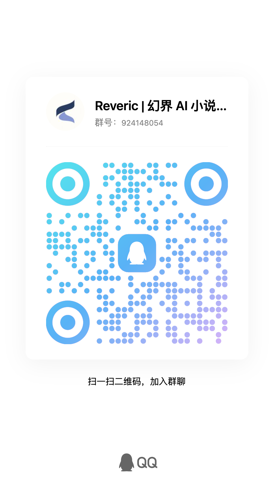

# Reveric | 幻界

### 作品全体を理解する AI ネイティブのデスクトップ スタジオ。最初の章から最終カットまで

  

  <a href="README.md">简体中文</a> •
  <a href="README.en-US.md">English</a> •
  <a href="README.ja-JP.md">日本語</a> ｜
  <a href="#主な機能">機能</a> •
  <a href="#エンドツーエンドのワークフロー">ワークフロー</a> •
  <a href="#対応モデル">モデル</a> •
  <a href="#ダウンロードとインストール">ダウンロード</a> •
  <a href="#クイックスタート">クイックスタート</a> •
  <a href="#フィードバックとコミュニティ">コミュニティ</a> •
  <a href="#ライセンス">ライセンス</a>

---

## スポンサー

<table width="100%">
  <tr>
    <td width="50%" align="center" valign="top">
      <a href="https://88api.ai/sign-up?aff=5q8X">
        
         
        <strong>88API トークン集約プラットフォーム</strong>
      </a>
      

        
      

      
<strong>本プロジェクトにご協賛いただいている 88API に感謝します！</strong>

      
88API は香港の企業が運営する、開発者、クリエイター、AI アプリケーションのユーザー向けの統合マルチモデル API プラットフォームです。テキスト、画像、音声、動画のモデルを単一のインターフェースで利用でき、AI コーディング、翻訳、コンテンツ制作、ナレーション、画像生成、動画生成に対応しています。高品質な DeepSeek の計算資源、主要な国際決済手段、請求書の発行、エンタープライズ級の信頼性を提供しています。

      
<a href="https://88api.ai/sign-up?aff=5q8X">紹介リンクから登録</a>すると、限定のボーナス クレジットを受け取れます！

      

        ウェブサイト: <a href="https://88api.ai/">88api.ai</a> 
        API ベース URL: <code>https://api.88api.ai</code>
      

    </td>
    <td width="50%" align="center" valign="top">
      <a href="https://metaso.cn/minimax-h3/?s=Reveric">
        
         
        <strong>MiniMax H3 動画生成 API | METASO</strong>
      </a>
      

        
      

      
<strong>本プロジェクトにご協賛いただいている METASO に感謝します！</strong>

      
METASO は、コストパフォーマンスに優れた MiniMax H3 の動画生成を提供しています: <strong>768P は 1 秒あたり ¥0.09 から、2K は 1 秒あたり ¥0.15 から</strong>。最長 30 秒のクリップ、ネイティブ 2K、同期した音声に対応しています。API は <strong>OpenAI 互換</strong>で、<strong>ComfyUI</strong> でも利用できるため、自分で GPU をデプロイする必要はありません。

      
🎁 <a href="https://metaso.cn/minimax-h3/?s=Reveric">Reveric の紹介リンクから登録</a>すると、ボーナス クレジットと限定特典を受け取れます。

      

        ウェブサイト: <a href="https://metaso.cn/minimax-h3/?s=Reveric">metaso.cn</a> 
        API ベース URL: <code>https://metaso.cn/api/minimax</code>
      

    </td>
  </tr>
</table>

---

## 概要

**Reveric (幻界) は、長編小説、脚本への翻案、ショートドラマ / アニメ漫画の制作のための、ローカルファーストでエージェントを中心に据えたデスクトップ クリエイティブ スタジオです。** 作品全体はお使いのデバイス上にあり、それがそのままエージェントの作業場所にもなります。章の執筆、脚本の翻案、絵コンテの配置、カメラの設定、最終動画の編集まで。必要なことを伝えるだけで、エージェントが作品の中で作業します。

- **必要に応じて作品全体を読む**: エージェントが必要な章や設定を自分で探すので、キャラクター設定をチャットに貼り付ける必要はありません。
- **エージェントがすべてのモジュールを操作**: 小説、脚本、キャンバス、3D Director Stage、Editing Suite のすべてで、エージェントが直接作業します。
- **アセットを自動生成**: キャラクターのビジュアル、絵コンテの参考画像、動画クリップ、音声をエージェントが生成し、そのままキャンバスに配置します。
- **ローカルファースト、自分の API キーを使用**: 作品はローカルの SQLite データベースに保存されます。OpenAI、Anthropic、Gemini、DeepSeek、Seedance、H3、またはセルフホストのゲートウェイに直接接続できます。

---

## 主な機能

| ステージ / モジュール | ワークスペースの機能 | エージェントがここで行うこと |
| :--- | :--- | :--- |
| **小説の執筆** | 階層型のアウトライン、自動保存、バージョンの差分、充実した設定資料 (キャラクター、勢力、伏線、地図)、エンティティの関係グラフ | 物語全体の文脈を踏まえて章を加筆、推敲、書き直しします。章の事実を抽出し、整合性をチェックし、キャラクターや関係の変化を追跡します |
| **脚本への翻案** | 柱 (シーン見出し)、登場人物、セリフ、ト書き、トランジションのプロフェッショナルな書式 | 原作小説からシーンを抽出し、エピソードに分割し、セリフとト書きを書きます |
| **無限キャンバス** | ノードベースの絵コンテ、キャラクターのビジュアル、映像・音声アセット、画像生成フロー | 脚本から絵コンテのノードを生成し、プロンプトを書き、画像 / 動画モデルを呼び出します |
| **3D Director Stage** | セットの配置、俳優の立ち位置、カメラの設置と動き、タイムラインでのプリビズ | カメラを配置し、カットと動きを計画し、フレームを書き出して構図を確認し、動画生成の参考にします |
| **マルチトラック編集** | 6 トラックのタイムライン (動画、オーバーレイ、セリフ、効果音、BGM、字幕)、分割と書き出し | 自動で編集します: クリップの配置、分割とトリミング、字幕の追加、音声の抽出、アスペクト比の設定、プレビューのレンダリング |

---

## エンドツーエンドのワークフロー

### 1. エージェント: 作品全体を任せる

エージェントは作品内のすべてのモジュールを操作できます。やりたいことを伝えると、対応するエディターで作業します。

- **小説**: 前の章や設定を読み、章を執筆・修正し、キャラクター、勢力、伏線を作成し、関係グラフを管理し、整合性をチェックします。
- **脚本**: 原作小説から翻案し、エピソードとシーンに分割し、セリフとト書きを書きます。
- **キャンバス**: 脚本から絵コンテのノードを配置し、プロンプトを書き、キャラクターのビジュアル、参考画像、動画クリップを生成します。
- **3D Director Stage**: カメラを配置し、カットとカメラワークを計画し、フレームを書き出して構図を確認します。
- **Editing Suite**: 自動編集とアセット処理: タイムラインへの素材の配置、クリップの分割・トリミング・並べ替え、字幕の追加、音声の抽出、素材の差し替え、アスペクト比の設定、プレビューのレンダリングとフレームの書き出しによる確認を行います。

文体、視点、避けたいことを常に守るルールとして保存できます。スキルをインストールまたはインポートして、できることを増やすこともできます。

---

### 2. 小説の執筆: 緻密な世界観構築と関係グラフ

章、アウトライン、キャラクター、伏線、参考資料、世界観、地図、イラスト付きの資料が、つながった 1 つのワークスペースにまとまっており、そのすべてをエージェントが参照できます。ペース配分、何を残すか、最終的な本文は作者が決めます。

- **章エディター**: ツリー形式のアウトライン ナビゲーション、自動保存、バージョンのスナップショット、ワンクリックの体裁整え。
- **設定資料集**: キャラクター、勢力、能力、伏線、場所、地図。関係グラフで、キャラクター同士の関係の変化と重要な節目を追跡できます。
- **AI との共同創作**: 加筆、推敲、書き直しの前に、エージェントに前の章や設定を読ませます。章を書き終えたら、重要な事実を抽出して整合性をチェックさせれば、設定との矛盾を防げます。

---

### 3. 脚本への翻案: プロフェッショナルな脚本執筆

既存の小説から翻案した脚本を作成できます。エディターは映画・テレビの脚本の慣習に沿っており、柱 (シーン見出し)、ト書き、登場人物、括弧書き、セリフ、トランジション、字幕を扱えます:

- **標準的な書式**: 流れを止めることなく、柱、ト書き、登場人物、セリフ、トランジションの間をスムーズに移動できます。
- **原作を並べて表示**: 左側で原作小説を読みながら、右側で脚本を書けます。エージェントは作品をまたいで原作を読み、シーン、セリフ、ト書きを抽出します。

---

### 4. 制作 · 無限キャンバス: ビジュアル絵コンテとマルチモーダル アセット

脚本を映像と音声の言語に変換するための中心となる場所です。キャラクターのビジュアル、シーンの展開、絵コンテのセグメント、生成された画像・音声・動画が、無限キャンバス上にノードとして配置されます:

- **ノード フロー**: 前後のショットの参照関係や画像プロンプトがひと目でわかります。
- **エージェントによる生成**: エージェントに脚本を絵コンテに分解させ、プロンプトを書かせ、参考画像や動画クリップを一括生成させます。
- **マルチモーダルな管理**: 参考画像、キャラクターのビジュアル、ショットのバッチを、ばらばらのフォルダーではなく 1 か所で管理できます。

---

### 5. 制作 · 3D Director Stage: 空間での立ち位置とカメラの設置

内蔵の 3D プリビズ エンジンで、撮影現場にいるように演出できます:

- **セットの配置と立ち位置**: キャラクターや小道具を 3D 空間に配置し、視線や空間の構図を確認できます。
- **カメラ設計**: クローズアップ、ロングショット、切り返しのアングルを設定し、ドリー、パン、ティルトの動きを計画できます。
- **タイムラインでのプリビズ**: タイムライン上でシーン全体をカットし、構図のフレームやプリビズ アニメーションを動画生成の参考として書き出せます。
- **演出をエージェントに任せる**: エージェントに脚本からカメラを配置させ、カットとカメラワークを計画させ、フレームを書き出して構図を確認させます。

---

### 6. 制作 · Editing Suite: マルチトラックのタイムラインと最終書き出し

ショートドラマやアニメ漫画のために作られた、マルチトラックのノンリニア エディターです:

- **6 トラックのタイムライン**: メイン動画、オーバーレイ、キャラクターのセリフ、環境効果音、BGM、多言語字幕。
- **精密な編集**: ブレードでの分割、リップル削除、スナップ。
- **ワンクリックで書き出し**: 外部ソフトウェアを介さずに、完成した動画を直接書き出せます。
- **編集をエージェントに任せる**: エージェントがキャンバスのアセットをタイムラインに配置し、分割、トリミング、字幕、音声を処理し、プレビューをレンダリングします。

---

## 対応モデル

Reveric は、ローカルファーストで自分の API キーを使う (BYOK) アーキテクチャを採用しています。長編文学の執筆でもショートドラマの制作でも、モデルの選択はクリエイターが完全に自分で決められます。

### 1. LLM と推論モデル

| プロバイダー / チャネル | 機能 | インターフェース プロトコル | 最適な用途 |
| :--- | :--- | :--- | :--- |
| **Anthropic** | テキスト生成、対話、ツール呼び出し | 公式 API | 長編小説の執筆、繊細な文章、文学的なセリフ (Claude 3.5 Sonnet 推奨) |
| **OpenAI** | テキスト生成、マルチモーダル、ツール呼び出し | 公式 API | プロットの構成、キャラクターの関係性、マルチエージェントの連携 (GPT-4o、o1、GPT-4 Turbo) |
| **Google Gemini** | テキスト生成、長いコンテキスト、マルチモーダル | 公式 API | 小説全体の分析、絵コンテの参考資料の解析 (Gemini 1.5 Pro / Flash) |
| **DeepSeek** | テキスト生成、深い推論 | OpenAI 互換 API | コスパの高い論理的推論、伏線の設計、どんでん返しの発見 (DeepSeek-V3 / R1) |
| **中国の主要プロバイダー** | テキスト生成、中国語の理解 | OpenAI 互換 API | Zhipu GLM、Alibaba Qwen、Moonshot Kimi、MiniMax など |
| **ローカル モデル / セルフホストのゲートウェイ** | オフライン推論、モデルの集約ルーティング | OpenAI / Anthropic 互換 | Ollama、LocalAI、AxonHub、OneAPI、NewAPI など |

### 2. 画像生成モデル

Reveric は無限キャンバスと設定資料集で主要な画像生成モデルにネイティブ対応しており、キャラクターの設定画、絵コンテの参考画像、背景美術、コンセプト小道具に利用できます:

| モデル / ファミリー | 主なモデル | 主な機能 | 連携チャネル |
| :--- | :--- | :--- | :--- |
| **ByteDance Seedream** | Seedream 5.0 (Pro/Flash/Lite)、4.5、4.0 | 2K-4K 解像度、複数画像による条件付け (14 枚以上の参照)、アスペクト比の自動調整 | Volcengine Ark 公式 API |
| **Alibaba Wan & Qwen Image** | Wan 2.7 Image Pro、Qwen Image 3.0 / 2.1 | 最大 4K 出力、参考画像のブレンド、高精度なインペインティングと画像編集 | Alibaba DashScope / 互換エンドポイント |
| **OpenAI** | GPT Image (gpt-image-2 / 1.5)、DALL-E 3 | 2K-4K のレンダリング、コンセプト デザインのイラスト、キャラクターのビジュアル参考 | 公式 API |
| **Google Gemini** | Gemini 3.1 Flash Image、Gemini Nano Banana 2.1 | 高速な生成、マルチモーダルな参照の解析、動的なアスペクト比 | 公式 API |
| **ゲートウェイとカスタム リレー** | 上記すべてのモデルを統合して振り分け | 統一されたリクエスト スキーマ、負荷分散、自動フェイルオーバー | OpenRouter、AtlasCloud、AxonHub、OneAPI |

### 3. 動画生成モデル

Reveric は主要な動画生成モデルをショートドラマの制作と無限キャンバスに統合しており、最初 / 最後のフレームの制御、複数の参考画像、柔軟なアスペクト比、カメラワークの制御に対応しています:

| モデル / ファミリー | 主なモデル | 主な機能 | 連携チャネル |
| :--- | :--- | :--- | :--- |
| **ByteDance Seedance** | Doubao Seedance 2.5 / 2.0 | 最初 / 最後のフレームの制御、複数の参考画像 (最大 30 枚以上)、アスペクト比の自動調整 | Volcengine Ark 公式 API |
| **Alibaba Wan** | Wan 2.7、Wan 2.6、Wan 2.5 | 映画のような質感、最初 / 最後のキーフレームの制御、動きの激しいシーンでの安定した動き | Alibaba DashScope / 互換エンドポイント |
| **MiniMax Hailuo** | Hailuo 3 Max、Hailuo 2.3、Hailuo 02 | 繊細な人物の動き、柔軟なアスペクト比 (16:9、9:16、21:9)、最初 / 最後のフレームの制御 | MiniMax 公式 API / アグリゲーター |
| **Kuaishou Kling** | Kling v3.0 (Pro/Std/4K/Turbo)、Kling O1 | 4K 解像度、最初 / 最後のフレームの固定、映画的なカメラワーク、複数のアスペクト比 | OpenRouter / AtlasCloud / 互換ゲートウェイ |
| **ゲートウェイとカスタム リレー** | 上記すべてのモデルを統合して振り分け | 1 つのプロトコルで複数の動画モデルを利用でき、自動フェイルオーバーに対応 | OpenRouter、AtlasCloud、AxonHub、OneAPI |

---

## ダウンロードとインストール

対応 OS 向けのビルド済みバイナリは [Releases](https://github.com/looplj/reveric/releases/latest) ページから入手できます:

| プラットフォーム | 推奨環境 | 形式 | 備考 |
| :--- | :--- | :--- | :--- |
| **macOS** | macOS 12.0+ (Apple Silicon / Intel) | `.dmg` | アプリケーション フォルダーにドラッグします |
| **Windows** | Windows 10 / 11 64 ビット | `-setup.exe` | 標準的な Windows のセットアップ ウィザード |
| **Android** | Android 8.0+ (ARM64) | `.apk` | モバイルでの閲覧や外出先でのアイデア出しに |

> **注**: アプリケーションのデータは、ローカルの SQLite データベースとプロジェクト フォルダーに保存されます。既存のバージョンの上から新しいリリースをインストールすると、作品と物語の設定は自動的に保持されます。

---

## クイックスタート

4 つの簡単なステップで、AI との共同制作スタジオを始められます:

1. **モデル プロバイダーの設定**
   左下の **Settings** ➔ **Model Settings** を開きます。AI プロバイダーを追加し、API キーとベース URL を入力したら、接続をテストしてプロバイダーを有効にします。
2. **プロジェクトの作成**
   ホーム画面で **New Project** をクリックして、小説または脚本を始めます。または、**Quick Start** を使って AI とアイデアを最初の物語設定に発展させたり、既存の TXT 原稿をインポートしたりできます。
3. **チャットで設定を作る**
   新しい作品を開くと、内蔵のオンボーディング ガイドがチャットでジャンル、文体、核となる設定を尋ね、執筆上の制約をエージェントのルールとして保存し、キャラクターと世界観を設定資料集に書き込みます。いつでも手動で追加できます。
4. **エージェントにタスクを任せる**
   「第 3 章を書いて」「第 1 巻を脚本に翻案して」「このシーンの絵コンテを作って参考画像を生成して」と伝えるだけです。エージェントが調べて実行します。その後、3D Director Stage でショットを演出し、Editing Suite で音楽と書き出しを仕上げます。

---

## フィードバックとコミュニティ

### フィードバック

バグを見つけた場合や機能のリクエストがある場合は、[GitHub Issues](https://github.com/looplj/reveric/issues) で issue を作成してください。

### QQ グループ

QR コードを読み取るか、[リンクから参加](https://qm.qq.com/q/Ap8pfOWHDO) (グループ番号: 924148054) して、AI による小説やショートドラマの創作について話し合い、コツを共有しましょう。

  

### その他のコミュニティ

- [LINUX DO コミュニティ](https://linux.do/): AI について学び、創作の経験を共有できます

---

## ライセンス

[AGPLv3](./LICENSE) のもとでライセンスされています。追加の条項とサードパーティの通知については [NOTICES](./NOTICES) をご覧ください。商用ライセンスについてのお問い合わせは [bababaa261@gmail.com](mailto:bababaa261@gmail.com) までご連絡ください。

---

**Reveric | 幻界** · あなたと一緒に創作するエージェント

[ホーム](https://github.com/looplj/reveric) • [Releases](https://github.com/looplj/reveric/releases) • [Issues](https://github.com/looplj/reveric/issues) • [QQ グループ](https://qm.qq.com/q/Ap8pfOWHDO)

