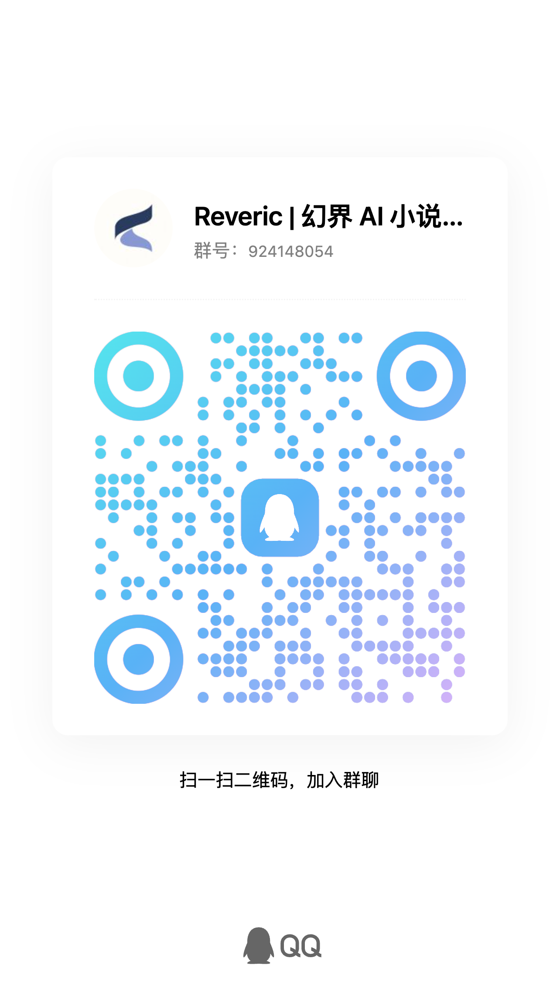

<div align="center">

# Reveric | 幻界

### AI Native 桌面创作工作台
**智能体读懂整部作品，和你一起从小说写到成片**

<p align="center">
  <a href="./LICENSE"></a>
  <a href="https://github.com/looplj/reveric/releases/latest"></a>
  
  
  
</p>

<p align="center">
  <a href="README.md">简体中文</a> •
  <a href="README.en-US.md">English</a>
</p>

<p align="center">
  <a href="#核心特性">核心特性</a> •
  <a href="#全流程展示">全流程展示</a> •
  <a href="#模型支持">模型支持</a> •
  <a href="#下载安装">下载安装</a> •
  <a href="#快速开始">快速开始</a> •
  <a href="#开发者指南">开发者指南</a> •
  <a href="#反馈与交流">反馈与交流</a> •
  <a href="#许可证">许可证</a>
</p>

</div>

---

## 赞助

<table width="100%">
  <tr>
    <td width="50%" align="center" valign="top">
      <a href="https://88api.ai/sign-up?aff=5q8X">
        
        <br/>
        <strong>88API Token 聚合平台</strong>
      </a>
      <p align="center">
        <a href="https://88api.ai/sign-up?aff=5q8X">
          
        </a>
      </p>
      <p align="left"><strong>感谢 88API Token 聚合平台赞助本项目！</strong></p>
      <p align="left">88API 是一家由香港企业运营、面向开发者、创作者与 AI 应用用户的一站式多模型 API 平台，通过统一接口接入文本、图片、语音和视频模型，覆盖 AI 编程、智能翻译、内容创作、配音、图像生成和视频生成等常见工作流。平台提供高质量 DeepSeek 算力，支持国际主流付款方式，可提供发票，并提供企业级稳定服务。</p>
      <p align="left">通过<a href="https://88api.ai/sign-up?aff=5q8X">专属链接注册</a>，可以获取专属赠送额度！</p>
      <p align="left">
        官网：<a href="https://88api.ai/">88api.ai</a><br/>
        请求地址：<code>https://api.88api.ai</code>
      </p>
    </td>
    <td width="50%" align="center" valign="top">
      <a href="https://metaso.cn/minimax-h3/?s=Reveric">
        
        <br/>
        <strong>MiniMax H3 视频生成 API｜秘塔科技</strong>
      </a>
      <p align="center">
        <a href="https://metaso.cn/minimax-h3/?s=Reveric">
          
        </a>
      </p>
      <p align="left"><strong>感谢秘塔科技赞助本项目！</strong></p>
      <p align="left">秘塔科技提供高性价比的 MiniMax H3 视频生成服务：<strong>768P 仅 0.09 元/秒，2K 仅 0.15 元/秒</strong>。支持 30 秒、支持原生 2K、音画同步，API 兼容 <strong>OpenAI 协议</strong>，同时支持 <strong>ComfyUI</strong>，无需自行部署 GPU。</p>
      <p align="left">🎁 通过 <a href="https://metaso.cn/minimax-h3/?s=Reveric">Reveric 专属链接注册</a>，即可领取赠送额度及专属优惠。</p>
      <p align="left">
        官网：<a href="https://metaso.cn/minimax-h3/?s=Reveric">metaso.cn</a><br/>
        请求地址：<code>https://metaso.cn/api/minimax</code>
      </p>
    </td>
  </tr>
</table>

---

## 项目简介

**Reveric（幻界）是一个本地优先、以智能体为核心的桌面创作工作台，覆盖长篇小说、剧本改编与短剧/漫剧制片。** 整部作品保存在你的设备上，同时也是智能体的工作区：写章节、改剧本、铺分镜、调机位、剪成片，说一句话，它就在作品里动手完成。

- **按需读取整部作品**：智能体自己检索需要的章节和设定，不用把人物小传复制进对话框。
- **智能体操作所有模块**：小说、剧本、画布、3D 导演台、剪辑台，智能体都能直接上手操作。
- **素材自动生成**：角色定妆、分镜参考图、视频片段与音频，由智能体调用模型直接生成到画布上。
- **本地优先，模型自选（BYOK）**：作品数据保存在本地 SQLite，模型直连 OpenAI、Anthropic、Gemini、DeepSeek、Seedance、H3 或自建网关。


---

## 核心特性

| 阶段 / 模块 | 工作台能力 | 智能体在这里做什么 |
| :--- | :--- | :--- |
| **小说创作** | 章节大纲、自动保存、历史版本对比、多维设定库（人物/势力/伏笔/地图）、实体关系图谱 | 基于完整设定扩写、润色、改写章节；提取章节事实、核验连续性，维护人物与关系变化 |
| **剧本改编** | 专业剧本排版，场次、角色、对话、动作与转场等核心元素 | 对照原著提炼场景、拆分剧集、编写台词与动作指示 |
| **无限画布** | 节点式铺展分镜段落、角色定妆、音视频资产与生图流 | 从剧本生成分镜节点，编写提示词，调用图像 / 视频模型产出素材 |
| **3D 导演台** | 3D 布景、角色摆位、机位与运镜调度、时间轴预演 | 布置机位、切镜与运镜，抽帧检查构图，作为视频生成参考 |
| **多轨剪辑** | 6 轨时间线（视频、叠加、对白、音效、音乐、字幕），分割与成片导出 | 自动剪辑：素材上轨、分割修剪、加字幕、分离音频、调整画幅，渲染预览 |

---

## 全流程展示

### 1. 智能体：整部作品都能交给它

作品里的每个模块，智能体都能直接操作。说一句话，它就在对应的编辑器里动手。

- **小说**：读前文和设定，写章节、改章节，创建人物、势力与伏笔，维护关系图谱，核对前后连续性。
- **剧本**：对照原著改编，拆分剧集与场次，编写对白与动作。
- **画布**：按剧本铺开分镜节点，编写提示词，生成角色定妆、参考图与视频片段。
- **3D 导演台**：布置机位、切镜与运镜，抽帧检查画面构图。
- **剪辑台**：自动剪辑与素材处理，把素材排上时间线，分割、修剪、排序片段，添加字幕、分离音频、替换素材、调整画幅，渲染预览并抽帧检查。

文风、视角、禁忌写法可以写成规则让它长期遵守，也可以安装或导入技能扩展它的能力。


---

### 2. 小说创作：深度世界观与动态关系图谱

章节、大纲、人物、伏笔、素材、世界观设定、地图和图鉴放在同一个作品工作区里，彼此关联，也全部向智能体开放。作者负责把握节奏、取舍与定稿。

- **章节编辑**：树状大纲导航、自动保存、历史版本快照、一键专业排版。
- **故事资产**：人物、势力、技能、伏笔、地点与地图，关系图谱记录角色关系的演变与重要节点。
- **AI 协作**：让智能体读完前文和设定再扩写、润色或改写情节；写完一章后，还能让它提取关键事实、核验前后连续性，避免设定吃书。


---

### 3. 剧本改编：专业剧本编辑器

支持以已有小说为原著创建改编剧本。编辑器遵循影视行业标准，包含场次、动作、角色、括号、对话、转场、字幕等核心元素：

- **标准化排版**：自如流转场次、动作、角色、对话与转场，写作思路不被打断。
- **原著对照**：左侧阅读小说原著，右侧编写剧本；智能体可以跨作品读取原著，提炼场景、台词与动作指示。


---

### 4. 短剧制片 · 无限画布：视觉化分镜与多模态资产

将剧本转换为视听语言的创作中枢。角色定妆照、场次节拍、分镜段落和生成的图片、音频、视频，均以节点形式在无限画布上铺开：

- **节点流转**：镜头上下游引用关系与生图提示词一目了然。
- **智能体生成**：让智能体按剧本拆分镜、写提示词、批量生成参考图与视频片段。
- **多模态管理**：集中管理参考图、定妆形象与镜头批次，告别散落的本地文件夹。


---

### 5. 短剧制片 · 3D 导演台：镜头调度与空间预演

内置 3D 空间预演引擎，像真正的导演一样在现场调度：

- **空间布景与角色站位**：在三维场景中摆放角色与道具，确认视线关系与空间构图。
- **机位与运镜设计**：自由设置特写、全景、正反打机位，规划推拉摇移运镜轨迹。
- **时间轴预演**：按时间轴切镜预演整场戏，导出构图参考图或预演动图，作为视频生成的参考。
- **交给智能体**：让智能体按剧本布置机位、安排切镜与运镜，并抽帧检查构图。


---

### 6. 短剧制片 · 剪辑台：多轨音视频一体化导出

专为短剧与漫剧打造的多轨非线性剪辑环境：

- **6 轨专业时间线**：涵盖视频主轨、画面叠加轨、角色对白轨、环境音效轨、背景音乐轨与多语言字幕轨。
- **精准编辑操作**：支持剪刃分割、波纹删除与多段吸附。
- **一键成片输出**：剪辑完成后直接导出成片视频，无需外部软件中转。
- **交给智能体**：智能体自动把画布上的素材排进时间线，完成分割修剪、字幕与音频处理，并渲染预览。


---

## 模型支持

Reveric 坚持 Local-First 与 BYOK（Bring Your Own Key）理念。无论是文学创作还是短剧制片，创作者对模型选择拥有完全自主权。

### 1. 文本与推理模型 (LLM & Reasoning)

| 提供商 / 渠道 | 支持能力 | 接入协议 | 适用场景 |
| :--- | :--- | :--- | :--- |
| **Anthropic** | 文本生成、对话、工具调用 | 官方 API 协议 | 长篇小说推演、细腻文学润色、剧本对白创作（推荐 Claude 3.5 Sonnet） |
| **OpenAI** | 文本生成、多模态、工具调用 | 官方 API 协议 | 剧情大纲架构、角色推演、智能体调度（GPT-4o, o1, GPT-4 Turbo） |
| **Google Gemini** | 文本生成、超长上下文、多模态 | 官方 API 协议 | 超长篇小说全景分析、分镜视觉参考解析（Gemini 1.5 Pro / Flash） |
| **DeepSeek** | 文本生成、深度推理 | OpenAI 兼容协议 | 高性价比剧情逻辑推理、伏笔设计与反转构思（DeepSeek-V3 / R1） |
| **国内主流厂商** | 文本生成、中文理解 | OpenAI 兼容协议 | 智谱 GLM、阿里通义千问、月之暗面 Kimi、MiniMax 等 |
| **本地 / 自建网关** | 离线推理、模型聚合分发 | OpenAI / Anthropic 兼容协议 | Ollama、LocalAI、AxonHub、OneAPI、NewAPI 等 |

### 2. 图像生成模型 (Image Generation)

Reveric 在无限画布与故事图鉴中深度支持主流图像生成模型，用于角色定妆、分镜视觉参考、场景道具与概念插画创作：

| 图像模型 / 厂商 | 代表型号 | 核心控制能力 | 接入方式 |
| :--- | :--- | :--- | :--- |
| **字节豆包 / 即梦 (Seedream)** | Seedream 5.0 (Pro/Flash/Lite), 4.5, 4.0 | 2K-4K 高清分辨率、最高 14+ 图参考、多种画幅比例自适应 | 火山引擎 Ark 官方渠道 / API |
| **阿里通义万相 & 通义千问** | Wan 2.7 Image Pro, Qwen Image 3.0 / 2.1 | 最高 4K 输出、多图参考融合、高精度图像重绘与局部编辑 | 阿里云百炼 / DashScope / 兼容接口 |
| **OpenAI** | GPT Image (gpt-image-2 / 1.5), DALL-E 3 | 2K-4K 渲染、概念插画设计、角色一致性参考 | 官方 API 协议 |
| **Google Gemini** | Gemini 3.1 Flash Image, Gemini Nano Banana 2.1 | 极速生图、多模态参考解析、丰富构图比例 | 官方 API 协议 |
| **聚合网关与自建服务** | 支持以上各类图像模型调度 | 统一请求封装、动态负载分发与故障转移 | OpenRouter, AtlasCloud, AxonHub, OneAPI |

### 3. 视频生成模型 (Video Generation)

Reveric 为短剧制片与无限画布深度集成了主流视频生成大模型，支持首尾帧锁定、多图参考、多画幅比例与运镜调度：

| 视频模型 / 厂商 | 代表型号 | 核心控制能力 | 接入方式 |
| :--- | :--- | :--- | :--- |
| **字节豆包 / 即梦 (Seedance)** | Doubao Seedance 2.5 / 2.0 | 首尾帧驱动、多图参考（最高 30+ 参考图）、自适应宽高比 | 火山引擎 Ark 官方渠道 / API |
| **阿里通义万相 (Wan)** | Wan 2.7, Wan 2.6, Wan 2.5 | 电影级质感、首尾帧关键帧控制、高动态稳定性 | 阿里云百炼 / DashScope / 兼容接口 |
| **MiniMax 海螺 (Hailuo)** | Hailuo 3 Max, Hailuo 2.3, Hailuo 02 | 细腻人像动态、多画幅比例（16:9, 9:16, 21:9 等）、首尾帧 | MiniMax 官方 API / 聚合渠道 |
| **快手可灵 (Kling)** | Kling v3.0 (Pro/Std/4K/Turbo), Kling O1 | 4K 超清分辨率、首尾帧控制、运镜参数调节、多种画幅比例 | OpenRouter / AtlasCloud / 兼容网关 |
| **聚合网关与自建服务** | 支持以上各类视频模型调度 | 一套协议统一调度多种视频模型，自动故障切换 | OpenRouter, AtlasCloud, AxonHub, OneAPI |

---

## 下载安装

在 [Releases](https://github.com/looplj/reveric/releases/latest) 页面获取对应平台的预编译安装包：

| 操作系统 | 推荐环境 | 安装包格式 | 说明 |
| :--- | :--- | :--- | :--- |
| **macOS** | macOS 12.0 及以上（Apple Silicon，arm64） | `.dmg` | 拖拽至 Applications 即可运行 |
| **Windows** | Windows 10 / 11 64-bit | `-setup.exe` | 运行安装向导即可完成配置 |
| **Android** | Android 8.0 及以上 (ARM64) | `.apk` | 移动端随行阅读与灵感速记 |

> **提示**：应用数据完全存储在本地（SQLite 数据库与本地工程文件夹）。升级新版本时直接覆盖安装即可，历史作品与设定会自动安全保留。

---

## 快速开始

只需四步，开启你的 AI 协同创作之旅：

1. **配置模型服务**
   打开左侧底部「设置」➔「模型设置」，添加你常用的 AI 供应商并填入 API Key 与 Base URL，测试连通后启用。
2. **创建你的作品**
   在首页点击「新建作品」，可选择小说或剧本；也可以通过「快速开书」输入灵感由 AI 协助生成开篇设定，或直接导入已有的 TXT 原稿。
3. **和智能体聊出设定**
   进入作品后，内置的创作向导会在聊天中询问题材、文风与核心设定，并把写作约束保存为智能体规则、把人物与世界观写入设定库。你也可以随时手动补充。
4. **把任务交给智能体**
   直接在聊天中说"写第三章"、"把第一卷改编成剧本"、"给这场戏拆分镜并生成参考图"，智能体会自己查资料、动手执行。随后进入 3D 导演台编排镜头，在剪辑台完成配乐与成片导出。

---

## 开发者指南

Reveric 采用 Flutter 与现代跨平台架构构建，欢迎社区开发者共同探索与改进。

### 技术栈

- **框架与语言**：Flutter 3.8+、Dart SDK
- **状态管理**：Riverpod (Hooks Riverpod) + Flutter Hooks
- **本地存储**：Drift (SQLite) Local-First 架构
- **3D 引擎**：Flutter Scene（3D 场景与镜头渲染）
- **多媒体处理**：FFmpeg Kit、FVP 视频播放引擎

### 本地编译与运行

```bash
# 1. 克隆代码仓库
git clone https://github.com/looplj/reveric.git
cd reveric

# 2. 安装项目依赖 (推荐使用 FVM 管理 Flutter SDK)
make deps
# 或者: fvm flutter pub get

# 3. 运行代码生成器 (Drift 数据库与 Riverpod 代码)
make codegen

# 4. 本地启动应用调试
make run-macos     # macOS 客户端
# make run-windows # Windows 客户端
# make run-linux   # Linux 客户端

# 5. 构建 Release 正式安装包
make build-macos-release   # 构建 macOS 客户端
make build-windows-release # 构建 Windows 客户端
```

---

## 反馈与交流

### 问题反馈

遇到缺陷或有功能建议，请提交到 [GitHub Issues](https://github.com/looplj/reveric/issues)。

### AI 小说 / 短剧交流

- [LINUX DO 社区](https://linux.do/)：学 AI、交流创作经验
- [QQ 群](https://qm.qq.com/q/Ap8pfOWHDO)（群号：924148054）：交流 AI 小说与短剧创作、分享使用心得

<p>
  <a href="https://qm.qq.com/q/Ap8pfOWHDO"></a>
</p>

---

## 许可证

本项目基于 [AGPLv3](./LICENSE) 授权开源，附加条款与第三方依赖声明详见 [NOTICES](./NOTICES)。商业授权请联系 [bababaa261@gmail.com](mailto:bababaa261@gmail.com)。

---

<div align="center">

**Reveric | 幻界** · 让智能体成为你的创作搭档

[主页](https://github.com/looplj/reveric) • [发行版](https://github.com/looplj/reveric/releases) • [问题反馈](https://github.com/looplj/reveric/issues) • [QQ 群](https://qm.qq.com/q/Ap8pfOWHDO)

</div>
