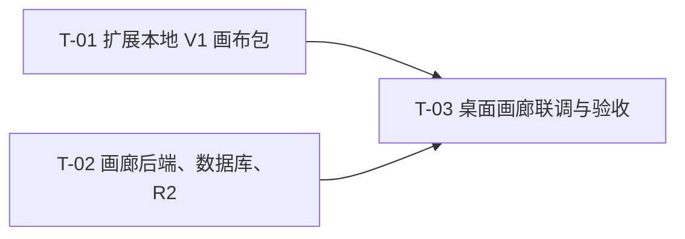

# 画廊方案

## 1. 背景

书架已经能导出和导入独立制作画布。用户要把可编辑画布分享给其他人，目前需要自己传 ZIP，接收者再从本机选文件导入。现有画布包保存节点和引用素材，但包内没有对话，自定义风格只能通过 ID 查找。 [画布包实现](../../lib/shared/services/production/canvas_package.dart) · [桌面导入导出入口](../../lib/desktop/features/production/package_actions.dart)

会话登记在应用库，消息在作品内容库，附件字节保存在会话目录。实现时需要把分散的引用归档为一份可移植的副本。 [会话持久化](../../lib/shared/services/ai/session_persistence.dart) · [会话文件](../../lib/shared/services/ai/files/session_files.dart)

## 2. 目标

1. Windows、macOS、Linux 用户能发布、浏览和一键导入独立画布作品。Android 上隐藏画廊入口和详情。
2. 整张画布及其引用素材随包发布。对话按会话多选，默认一条也不选。每条选中对话连同引用文件一起发布。
3. 上传完成即上架，无需审核，发布者无法撤回。发布副本固定为用户确认的内容。
4. 画廊详情复用现有聊天 UI，只读展示选中的对话与附件。复制到书架只创建新的可编辑画布及其素材。既有 `.canvas.zip` 仍可用。

首版的共享入口和详情均在桌面客户端。覆盖范围以这项独立画布发布能力为限。

## 3. 用户故事

- 作者希望把整张制作画布发出去，并挑选能解释创作过程的对话，让别人可以复用画布和素材。
- 浏览者希望在画廊查看参考对话和附件，再一键复制画布及素材到书架，继续编辑画布。
- 作者希望上传中断后接着传，避免重复打包或生成两条发布。维护者能暂停新投稿，已有内容继续可导入。

## 4. 解决方案

### 决策

采用现有画布 ZIP 的版本化扩展。画布、对话和附件共享一次确认和一份 ZIP。画廊详情读取对话部分，复制到书架复用现有画布恢复流程，读取画布部分及其素材。

### 用户操作与信息归属

1. 用户从画布书架的作品菜单打开「发布到画廊」。标题沿用作品名，可修改，简介可选。画布部分展示整张画布的缩略图、素材数和大小估算。会话列表只展示当前作品已保存、未软删除、`parentId == null` 且 `mode == 'chat'` 的对话。每项显示标题、最近活动时间、消息数和文件数，可展开查看。最终封面在打包后由确认页展示。
2. 用户可以直接发布画布，也可以勾选若干会话。发布前保存画布编辑，然后立即以当前已落库的用户可见消息和已有文件生成快照。运行中的回复或工具任务可以继续，打包无需等待。它们之后写入的结果留在本地。确认页展示确切的包大小、会话及文件清单。快照中已有引用却缺失文件时，定位到对应素材或会话，用户可修复后重新打包，或取消勾选有问题的会话。
3. 确认页明确提示「整张画布、引用素材和已选对话及其文件将公开。发布后无法撤回。」确认后发送刚才检查过的那份包。上传界面显示进度，保留当前发布弹窗即可在网络中断后继续传。服务器确认包和封面都写入并通过校验后立即上架。
4. 画廊先显示置顶画布，同组按管理员设置的排序值从大到小排列。排序值相同时，新发布的画布排在前面。卡片显示标题、简介、封面、包大小、发布时间、会话数和置顶状态。详情显示节点数、素材数和对话文件数，可用现有聊天消息界面只读查看选中的对话和附件。用户点「复制到书架」后，客户端校验归档，创建并打开一份包含画布和所引用素材的可编辑作品。

| 内容 | 保存位置 | 编辑与读取 |
| --- | --- | --- |
| 原始画布、会话和文件 | 本机作品及会话存储 | 现有编辑器继续维护。保存后的内容在下一次打包时采集。 |
| 标题、简介与会话选择 | 本次发布确认页 | 标题在打包前确定，同时用于 ZIP 和创建接口。确认过的包可在当前弹窗内重试，改变标题或选择需重新打包和确认。 |
| 已发布副本 | 后端数据库中的发布记录与 R2 归档 | 画廊列表、详情和下载读取同一发布版本。 |
| 画廊顺序 | `canvas` 的 `is_pinned` 与 `sort_order` | 管理员通过部署侧管理命令修改。客户端刷新列表后读取新顺序。 |
| 随附对话 | R2 归档中的消息及文件 | 在画廊详情通过现有聊天 UI 查看，随发布版本固定。 |
| 导入副本 | 接收者的新作品和素材库 | 通过现有画布编辑器查看与修改。 |

### 核心原则与假设

确认页对应一份固定归档。文件先直传，后端校验归档与封面后才创建画廊条目。画廊列表以 `canvas` 表为准。容量约束见第 8 节。

## 5. 方案实施

### 5.1 模型设计

复用现有 `.canvas.zip` 和 `production.canvas` **V1**。`styles`、`conversations`、`conversation_files` 及其 ZIP 条目是可选扩展。缺省时按空集合读取，已声明的文件引用仍需齐全。画廊和本地文件使用同一个导入入口。

| 内容 | 包内范围 |
| --- | --- |
| 画布 | 全部节点、分组、摆放位置、连线、节点文本及提示词，也包括作品中的导演台和剪辑文档及其引用。 |
| 素材 | 画布直接或间接引用的图片、视频、音频、参考文件及已采用生成结果。按引用收集实际文件字节，共用素材只打包一次，作品之外且无引用的素材留在本机。 |
| 制作设置 | 比例、分辨率、内置风格标识和自定义风格定义。自定义风格现有导出只存 ID，新格式保存名称和提示词前后缀，导入时重建并改写引用。画廊发布将作者的模型名称和模型参数保存在可选预览数据中，供只读展示。作者设备的 `provider_id` 留在本机。 |
| 对话 | 用户明确选择的会话及其已保存的聊天内容，保留现有消息和块的展示结构、顺序及标题。`model` 和 `agentSlug` 可作为历史信息保存，会话的 `provider` 留在本机。子代理内部会话、系统提示、内部运行状态和未发送草稿留在本机。 |
| 对话文件 | 现有聊天界面可见的附件和图片，保留其原有展示位置。工具内部结果里界面未展示的文件留在原作品。 |

#### 文件引用

会话登记在应用数据库里，消息在作品内容库里，附件字节在 `SessionFiles` 的作品与会话目录下。导出通过作品 ID 验证会话归属，读取已保存的 `AiMessage` 和支持现有 UI 的消息块。附件和图片沿用各自的展示类型，文件取自其可读的归档来源。只有外链或失效路径的文件按缺失处理，可先归档到作品后再打包。

`manifest.json` 保留画布主体与素材清单，新增 `styles`、`conversations`、`conversation_files`。会话清单记录包内 ID、标题、时间、可选的 `model` 和 `agent_slug`，以及 `chats/<id>.json` 路径。每份对话记录按现有聊天 UI 的消息结构顺序保存。附件和图片块用包内 `file_id` 指向文件，文件清单记录展示名、MIME、大小和 `files/<id>.<ext>` 路径。画布素材和对话引用同一文件时可共用一个包内条目。

导出保留现有消息 UI 使用的内容字段，`system_remind` 等内部消息、模型回放标识、工具原始参数、执行权限和服务商请求信息留在本机。用户可见的历史图片与工具卡沿用现有块类型。文件引用写成包内 ID，发布端本地路径不进包。

#### 软删除边界

以打包时的有效记录为准。仍处于软删除状态的画布内容、素材、风格和会话留在本地，回收站记录及仅由这些记录引用的文件也留在本地。已恢复的记录按正常内容处理。活跃内容若仍引用已删除的必要资源，发布前报告具体对象和引用，修复后重新打包。打包时重新检查会话归属、未删除状态、`parentId == null` 和 `mode == 'chat'`。会话正文中已经保存的文字按会话快照处理。

#### 画廊数据

| 后端表 | 主键与主要字段 | 用途 |
| --- | --- | --- |
| `canvas_upload` | 主键 `id`，唯一 `request_id`，`upload_token_hash`、`external_upload_id`、`cover_key`、`content_key`、`cover_size_bytes`、`content_size_bytes`、`created_at`、`expires_at`，可空的 `validation_failed_at` 和 `validation_error_code` | 一条临时记录对应一张封面和一份 ZIP。`external_upload_id` 是 R2 分片上传 ID。分片进度与 ETag 从 R2 查询。两列校验结果用于人工巡检。 |
| `canvas` | 主键 `id`，唯一 `canvas_upload_id`，`title`、`description`、`cover_key`、`content_key`、`content_version`、`content_size_bytes`、`node_count`、`asset_count`、`conversation_count`、`conversation_file_count`、`published_at`、布尔 `is_pinned`（默认 `false`）、整数 `sort_order`（默认 `0`） | 两份文件通过校验后才插入。`canvas_upload_id` 用于创建重试去重，`cover_key` 和 `content_key` 用于构建公开 URL。排序索引见第 5.3 节。 |

### 5.2 ERD

```text
canvas_upload 1 ── 0..1 canvas（canvas.canvas_upload_id）
canvas_upload 1 ── 1 R2 MultipartUpload ── N Part
canvas ── cover_key、content_key ── R2 JPEG、R2 ZIP
ZIP 1 ── 0..N Conversation 1 ── N Message
Message N ── N ArchiveFile（包内 ID 引用）
```

关联由 `canvas.canvas_upload_id` 保存。重复创建时从该索引查回原有画布。上传到期只处理尚未被 `canvas` 引用的临时文件。发布记录和对象独立保留。对话及其文件在 ZIP 内供画廊详情读取。

### 5.3 关键业务流程

#### 捕获与恢复

标题和会话选择确定后，从同一份暂存数据生成清单、封面与 ZIP。数据库采集使用短读事务，流式复制文件时核对大小和修改时间。确认对应固定的临时封面与 ZIP。变更标题或会话选择时重新打包并确认。本地后续编辑继续写入原作品。

客户端在首次查看对话或复制画布时下载并校验 ZIP，两项操作共用应用临时目录里的同一份文件。导入器检查已知必需字段和引用，忽略未知字段及合法的未引用 ZIP 条目。路径穿越、符号链接、重复条目和解压限额仍按现有安全校验处理。复制只解出和导入画布节点、引用素材和自定义风格。节点、素材和风格用新 ID 映射，保留原文件的显示名，包括中文名。作品重名时沿用现有导入流程追加编号。

画廊列表和详情读发布记录的 `title` 与 `description`。客户端将确认后的同一个标题写入 `manifest.json.title` 和创建请求。复制把 ZIP 交给现有 `ProductionCanvasPackageOrchestrator.importFile`，新作品以 ZIP 内标题为准，重名时沿用现有编号。画廊简介只用于展示，`novels.description` 沿用现有导入的空值。进度和失败处理也复用书架导入。 [现有画布包导入](../../lib/shared/services/production/canvas_package.dart)

#### 生成封面

封面取自与 ZIP 相同的画布快照。复用 `canvas_preview.dart` 的离屏布局、节点和连线渲染，按整张画布取景。封面模式省略坐标刻度、诊断网格和红色重叠提示。现有 AI 布局检查继续使用原预览模式。 [现有离屏预览](../../lib/shared/services/production/canvas_preview.dart)

封面从长边最多 1600 像素、JPEG 质量 85 开始编码。输出超过 2 MiB 时，依次尝试质量 70 和 55。若仍超限，把长边上限依次降至 1024 和 768 像素，仅在超过上限时等比缩小，以质量 55 重新编码。首个满足大小限制的版本作为确认页所见的 `cover.jpg`，直接用于上传。渲染或编码失败、所有结果均超限时，显示生成封面失败，可在发布弹窗里重试。

#### 只读画布预览

画廊发布将作者的模型名称和模型参数写入片段的可选 `preview_generation` 字段。只读预览按原值展示，不查询接收者本机的渠道、模型目录或模型能力。包体校验仍检查字段类型、画布引用和渲染所需的基本格式。

复制画布沿用现有导入流程，保留画布、提示词、输入引用和素材。新片段使用现有未选择模型的生成配置，`provider_id` 和 `model_id` 均为空。`preview_generation` 由预览读取。用户可在复制后的画布上选择本机渠道与模型，按正常流程生成。 [画布包导入](../../lib/shared/services/production/canvas_package.dart) · [片段保存](../../lib/shared/services/storyboard/service.dart)

#### 复用聊天 UI

画廊详情打开对话时，读取 ZIP 中选中的消息和对应文件。用 `groupMessagesForUi` 分组后交给现有 `ChatMessageView` 渲染。展示时把包内文件 ID 解析为本次解出的临时文件，沿用现有附件和图片预览。详情留在只读消息视图，`activeSessionId`、作品上下文和修改回调均为空。分享的对话不能续聊，聊天记录也不会进入复制后的作品。 [消息分组](../../lib/shared/widgets/ai/chat/ui_message.dart) · [现有消息 UI](../../lib/shared/widgets/ai/chat/chat_message_view.dart)

#### 上传和存储

```text
桌面 App ── 申请上传、创建和查询画布 ──> 匿名服务 ──> Ent / SQLite
桌面 App ── 签名 PUT 上传封面和 ZIP 分片 ──> R2 S3 端点
匿名服务 ── S3 API 查询、完成并校验上传 ──> R2 S3 端点
桌面 App ── 公开 GET 读取封面和 ZIP ──> gallery.reveric.app
```

画廊 HTTP API 接入 `reveric-backend/api-anonymous` 的现有匿名服务，复用 `https://anonymous-api.reveric.app`、Go HTTP 路由和 Ent / SQLite。投稿沿用匿名流程。R2 写入凭据由该后端保管，授权范围限定到 `reveric-gallery` 桶。

封面和 ZIP 直传同一个 R2 桶 `reveric-gallery`，对象键分别为 `canvas-files/<upload_id>/cover.jpg` 和 `canvas-files/<upload_id>/package.canvas.zip`。`https://gallery.reveric.app` 绑定为桶的公开读取域名。已发布画布的 URL 由域名和 `canvas` 保存的对象键组成，客户端直接 GET，ZIP 支持 Range 续传。写入使用 R2 S3 端点上的短期签名。 [R2 公开桶与自定义域名](https://developers.cloudflare.com/r2/buckets/public-buckets/) · [R2 预签名 URL](https://developers.cloudflare.com/r2/api/s3/presigned-urls/)

1. **申请上传。** 客户端带封面和 ZIP 的大小调用 `POST /gallery/canvas/upload`。后端检查限额，为两个文件生成 `upload_id` 和固定对象键，为 ZIP 调用 `CreateMultipartUpload` 并保存 `external_upload_id`。响应包含封面的签名 PUT URL 和 ZIP 的签名分片 URL。此时只写 `canvas_upload`。
2. **直传 R2。** 客户端按返回的请求头 PUT 文件。封面单次写入，签名包含 `If-None-Match: *`，确保已写入的封面不能被旧 URL 覆盖。ZIP 每条 URL 绑定对象键、R2 分片上传 ID、分片号和预期长度。断线或 URL 过期时，客户端带同一个 `upload_id` 调用原接口。后端查 R2 的封面和分片进度，仅为缺失或长度不符的分片重新签名。 [R2 预签名 URL](https://developers.cloudflare.com/r2/api/s3/presigned-urls/) · [R2 条件写入](https://developers.cloudflare.com/r2/api/s3/conditional-operations/)
3. **创建画布。** 客户端传完后调用 `POST /gallery/canvas`。后端校验上传凭证，按 `upload_id` 串行执行创建与到期处理。从 R2 检查封面及分片，使用 `ListParts` 的 ETag 清单调用 `CompleteMultipartUpload`。封面和归档通过第 5.3 节的校验后插入 `canvas` 并直接上架。成功重试按唯一的 `canvas_upload_id` 返回原有 `canvas_id`。如果 R2 已合并而数据库写入失败，重试校验现成 ZIP 后继续创建。 [R2 S3 兼容接口](https://developers.cloudflare.com/r2/api/s3/api/)

签发范围固定为一张 JPEG 和一份 `production.canvas` V1 ZIP。ZIP 按 **8 MiB（8,388,608 字节）**切片，最后一片可短于 8 MiB。签名绑定每次 PUT 的预期字节数，封面额外绑定 `image/jpeg`。首版默认 ZIP 上限 2 GiB、封面上限 2 MiB、上传会话 24 小时、签名有效期 15 分钟，签名最晚随会话到期。全站与单来源对新建会话和签发限流。到期只处理未被 `canvas` 引用的上传，已发布对象持续保留。

续传范围是当前发布弹窗和应用进程。随机上传凭证、`Idempotency-Key` 与 `upload_id` 放在本次操作的内存中，ZIP 和封面放在本次操作的应用临时目录。弹窗关闭时结束本次客户端上传并清理临时文件，应用重启后从新上传开始。离开后的 R2 分片和对象按原有 24 小时会话到期规则处理。

画廊只展示 `canvas` 表中的条目。同桶对象一旦写入，知道对象 URL 的人即可读取。封面完成单次 PUT 后即可读取，ZIP 在 R2 完成合并后可读取。暂停投稿后，已上架条目和公开文件继续可访问。

#### 文件校验与人工巡检

- **封面**核对 R2 上的实际字节数和 2 MiB 上限。读取文件后先识别 JPEG 与尺寸，宽高均在 2048 像素以内再解码验证。
- **ZIP** 合并后先核对对象总大小。只用 Range 读取 ZIP 目录和 `manifest.json`，确认格式为 `production.canvas` V1，校验条目路径、数量及清单所声明素材和对话文件是否齐全。合法的额外字段和未引用条目允许存在。沿用现有的 10,000 条目、清单解压 32 MiB 和总解压 8 GiB 上限。客户端在预览对话或导入画布时分别校验实际读取的媒体字节。
- **校验失败**时，在 `canvas_upload` 记录 `validation_failed_at` 和 `validation_error_code` 后返回 `422`，画廊列表无此条目。网络错误或 R2 暂时不可用按可重试错误处理。管理员用部署侧命令 `canvas-admin list-invalid-uploads --db <数据库文件>` 查看失败时间、原因和两个 R2 对象键，并人工巡检处理。失败标记独立于文件到期清理，文件过期后仍可巡检该记录。

#### 画廊排序与管理

列表按 `(is_pinned DESC, sort_order DESC, published_at DESC, id DESC)` 排列，后端建立对应的复合索引。游标记录最后一条的四个排序值。下一页从该位置之后读取，同一发布时间也有固定次序。客户端翻页时按 `canvas_id` 去重，重新刷新从首页读取当前顺序。

首版由具备服务端权限的管理员运行 `canvas-admin set-order --db <数据库文件> --id <canvas_id> --sort-order 100 --pinned=true`。两个属性可单独修改，也可在一次命令一起修改。传 `--pinned=false` 取消置顶。`sort_order` 允许负值，`0` 为默认。命令只更新排序字段，通过输出的当前值确认操作结果。公开的创建接口使用默认值。

#### API 契约

写入采用两个画布专用端点。临时 `upload_id` 用于申请签名和提交文件，`canvas_id` 在创建成功时分配。客户端在首次申请前生成随机上传凭证，两个写接口使用 `Authorization: Bearer <本次上传凭证>`。首次申请带 `Idempotency-Key`，同一凭证、键及文件规格重试得到同一个 `upload_id`。直传 R2 时只携带签名 URL 所要求的请求头。

| 方法与路径 | 输入 | 成功结果 |
| --- | --- | --- |
| `POST /gallery/canvas/upload` | 首次传 `cover_size_bytes` 和 `content_size_bytes`。续签带原 `upload_id`。 | `200`。返回 `upload_id`、`expires_at` 和 `urls`。`urls.cover` 包含 `url`、`headers` 和 `expires_at`，封面已上传时为 `null`。`urls.parts` 列出缺失分片的 `part_number`、`url`、`headers` 和 `expires_at`。分片编号从 1 开始。 |
| `POST /gallery/canvas` | `upload_id`、`title`、可选 `description`。标题去掉首尾空白后为 1～80 个 Unicode 字符，简介最多 500 个 Unicode 字符。客户端输入与服务端使用同一上限。 | `201`。完成 R2 分片上传并创建画布，返回 `canvas_id`、`published_at`。同一上传和相同文案的重复提交返回 `200` 和原结果。 |
| `GET /gallery/canvas?cursor=…` | 后端返回的不透明游标，首次可省略。 | `200`。返回 `items` 和 `next_cursor`，固定每页最多 20 条。卡片包含 `canvas_id`、`title`、`description`、`cover_url`、`published_at`、`content_size_bytes`、`conversation_count`、`is_pinned`。按第 5.3 节的排序规则分页。 |
| `GET /gallery/canvas/{id}` | 画布 ID。 | `200`。返回卡片字段及 `content_url`、`content_version`、`node_count`、`asset_count`、`conversation_file_count`。封面和 ZIP URL 均指向 `gallery.reveric.app`。 |

`POST /gallery/canvas/upload` 的首次请求示例。此例的 ZIP 为 12 MiB，签发两个分片，长度分别为 8 MiB 和 4 MiB。

```json
{
  "cover_size_bytes": 131072,
  "content_size_bytes": 12582912
}
```

`POST /gallery/canvas` 的请求体示例。节点、素材、对话及对话文件数量从校验过的 `manifest.json` 生成。素材与对话文件分别按清单计数，文件去重不会改变引用。

```json
{
  "upload_id": "upl_8n2fk",
  "title": "雨夜追逐分镜",
  "description": "含镜头布局、参考素材和两段创作对话"
}
```

对话选择在桌面端完成。消息和附件随 ZIP 传输，公开接口返回计数。详情使用现有聊天 UI 读取 ZIP 中的对话，复制在校验文件长度和包格式后创建本地画布。

错误体沿用匿名服务的 `error` 对象，可带机器可读的 `code`。标题或简介不合规则返回 `400 invalid_metadata`。封面或分片缺失返回 `409 upload_incomplete`，附 `missing_parts` 和 `cover_missing`。同一上传正被提交时返回 `409 upload_finalizing`，客户端按 `Retry-After` 重试同一请求。重复使用申请键提交不同文件规格，或重复提交已发布上传但文案不同，返回 `409 upload_conflict`。凭证无效返回 `401`，过期返回 `410`，文件超限返回 `413`。封面或归档校验失败按第 5.3 节标记该次上传并返回 `422`。限流返回 `429`，停止投稿返回 `503`。日志用上传 ID、阶段、字节数和错误码定位，凭证、签名 URL 和文件正文留在日志之外。客户端导入前校验归档及完整引用。

### 5.4 改动清单

#### `lib/shared/services/production/canvas_package.dart`

- `ProductionCanvasPackageOrchestrator.exportToFile` 保持 V1，按选中的会话写入可选字段和条目。`importFile` 移除字段集合与 ZIP 条目集合必须完全相等的检查，验证必需字段与引用，跳过合法的未引用条目。安装步骤只处理画布和引用素材。
- 画廊发布时，片段的导入配置采用未选择模型的默认值，原模型和模型参数写入可选的 `preview_generation`，由只读预览读取。复制仍使用现有的片段创建与保存逻辑。
- 发布对话列表复用 `AiSessionPersistenceService.watchSessionsByMode` 的 `chat` 查询。新增同目录 `canvas_package_conversations.dart`，通过现有持久化服务加载已保存消息与文件，并提供解包后的只读消息数据。会话元信息保留 `model` 和 `agent_slug`，省略本机实例字段 `provider`。
- `lib/shared/services/production/canvas_preview.dart` 复用离屏渲染器，为发布快照增加封面渲染与限大小编码。AI 布局检查的默认输出仍使用现有诊断图样式。

#### 桌面入口与画廊

- `lib/desktop/widgets/novel_list.dart` 的画布作品操作添加发布入口。`lib/desktop/pages/home.dart` 的画布书架添加画廊入口。
- `lib/desktop/features/production/package_actions.dart` 的本地导出接收可选会话，抽出文件导入与画廊复制共用的「导入已取得的 ZIP」入口。遇到客户端无法读取的包结构时提示升级客户端。缺文件等具体故障仍使用对应错误提示。
- 新增 `lib/desktop/features/canvas_gallery/` 的 `page.dart`、`detail.dart`、`publish_dialog.dart`，分别处理目录、详情和发布确认。详情从 `preview_generation` 读取画布预览的模型名称和参数，并复用 `groupMessagesForUi` 与 `ChatMessageView` 展示对话。新增 `lib/shared/services/canvas_gallery/` 的 `service.dart` 与 `orchestrator.dart`，分别负责 API 请求及归档下载和导入编排。
- `lib/shared/localization/locale_keys.dart` 与 `assets/translations/{en,zh-CN}/production.json` 同步加入画廊、会话选择、公开确认、进度和失败文案。

#### 画廊后端

- 在 `reveric-backend/api-anonymous` 的 `internal/server/routes.go` 注册四个画布路由。发布服务负责签名、完成 R2 分片上传、校验归档与创建画布。读取接口用对象键生成公开文件 URL。
- 在 `internal/ent/schema/` 添加 `canvas_upload` 和 `canvas` 的 Ent schema，沿用 `internal/server/db/ent.go` 的数据库入口。增加 SQLite 和 S3 兼容测试，验证续签、创建去重和文件直读。
- 新增 `cmd/canvas-admin/main.go`，通过 `set-order` 更新排序与置顶，通过 `list-invalid-uploads` 列出待人工巡检的失败记录。列表查询与游标使用同一组排序字段。
- 部署继续使用现有匿名服务。上线前确认 `reveric-gallery` 的写入凭据已配置给后端，并验证 `gallery.reveric.app` 的 R2 公开域名绑定。先用测试数据库与 S3 兼容环境验证，再使用合成画布实际跑通直传和直读。

### 5.5 Migration

复制画布沿用已有画布和素材表，应用库和作品库的 Drift schemaVersion 保持当前值。对话作为归档展示数据。现有 V1 ZIP 直接读取，缺省的扩展字段按空集合处理。已经安装的旧版客户端遇到新增字段或条目时可能拒绝导入，遇到这种情况升级客户端即可。

后端初始迁移新增画廊表和索引。迁移成功后开放投稿，失败则保持入口关闭，修复后重试。客户端回退时可以关闭画廊入口，服务端可单独停止新增投稿。已发布对象和索引保留供受支持的客户端读取。

### 5.6 上线后验证

部署后用合成画布发布并从另一台设备查看，核对封面与 ZIP 都从 `gallery.reveric.app` 读取。用现有聊天 UI 打开对话与附件，再复制画布到书架。首周每日检查上传和创建失败码。若 R2 已合并 ZIP 而创建反复失败，按 `upload_id` 核查已写入的对象和数据库记录，必要时暂停新增投稿。

### 5.7 业务监控与数据分析

| 业务问题 | 口径与数据来源 | 查看时机与行动 |
| --- | --- | --- |
| 投稿是否顺利完成 | 从后端数据库按周统计已经过到期窗口的 `canvas_upload`，分母为该期创建的上传，分子为其中被 `canvas` 引用的上传。按上传 ID 去重，排除测试库。 | 内测首周建立基线，后续每周看分片、封面和创建相关错误，优先处理主要中断点。 |
| 作者是否会带上对话 | 从同一批已上架的画布发布统计 `conversation_count > 0` 的数量及占比。 | 首周和后续每周看变化。结合内测反馈决定是否改进选会话与文件预览。 |
| 画布能否顺利被复用 | 用内测受控样本记录成功复制并打开画布的数量，以尝试复制的样本数为分母。 | 首次放量前核对。R2 的文件请求量与实际复制次数分开统计。 |

复用数据库查询、后端错误日志和受控验收，首版无需增加客户端埋点。样本不足时只报告实际数量及覆盖范围。

## 6. 验收标准

| 验收范围 | 通过条件 | 验证方式 |
| --- | --- | --- |
| 全量画布与兼容 | 分组、导演台、剪辑、自定义风格、图片、音频和视频可导入并继续编辑。原有 V1 包及新增可选扩展的 V1 包均可导入。未知字段和合法的额外条目不影响导入。遇到客户端无法读取的包结构时提示升级。删改原作品后，画廊包和导入副本保持原样。 | 使用原有包、带可选扩展的包及带未知字段或安全额外条目的包做兼容测试。 |
| 对话选择 | 零选和多选均可发布。选择器只列当前作品有效的顶层 `chat` 会话。正在回复或运行长任务时仍能打包，包内包含快照时已保存的可见消息和已有文件。未选会话及其独占文件留在本地。 | 用顶层 `chat`、子代理会话、特殊模式和运行中长任务分别验证。 |
| 只读展示与复制 | 画廊详情复用现有消息 UI，可打开原聊天界面可见的附件和图片，展示顺序一致。详情不能续聊或修改作品。复制后新作品只有画布和引用素材。 | 查看带图片和普通附件的对话，再复制到书架，并检查没有新增会话、消息或对应会话文件。 |
| 模型配置 | 缺少作者模型的设备仍能只读查看模型名称和原参数。复制后模型和渠道未选定，画布内容与素材可编辑。会话的模型与 Agent 标识随只读记录展示。 | 在未配置作者模型的客户端打开预览，再复制并检查新片段的生成配置。 |
| 内容边界 | 软删除记录及仅由它们引用的文件不进入 ZIP。活跃内容引用已删除的必要资源时能定位引用。缺失附件能定位到会话。无效归档不会创建可见作品。 | 软删除与恢复用例、无效包验证。 |
| 发布校验与巡检 | 伪装的 JPEG、尺寸超限的封面、非法归档或缺引用文件的 ZIP 返回 `422`，留下失败时间与错误码。管理员可以查到对应上传和 R2 对象键。网络暂时失败时仍可重试。 | 构造伪装封面和无效 ZIP，核对 `canvas_upload`、画廊列表及管理命令输出。 |
| 封面生成 | 书架没有封面的画布也可生成可解码的 JPEG。封面与 ZIP 对应同一画布快照，成品最多 2 MiB，且没有坐标刻度或重叠告警。 | 用高细节素材验证压缩与缩放分支，检查确认图与上传字节一致，复跑 AI 预览用例。 |
| 传输与发布 | JPEG 和 ZIP 直传 R2。ZIP 按 8 MiB 切片，续签只返回所缺分片。当前弹窗断线可续传，关闭弹窗或重启后从新上传开始。文件到齐并通过校验后才创建 `canvas`。重复创建返回同一个 ID，R2 合并后数据库写入失败可重试。 | 用签名 URL 实际 PUT 封面和分片，注入网络、签名过期、合并与数据库故障，再检查关闭弹窗和重启。 |
| R2 直读 | 列表的封面 URL 和详情的 ZIP URL 都指向 `gallery.reveric.app`，客户端可直接读取，ZIP 支持从中断位置续传。 | 在测试环境访问公开 URL，检查范围请求结果与实际 ZIP。 |
| 画廊排序 | 置顶优先，同组排序值大的在前，排序值相同时按发布时间和 ID 倒序。管理员可调整排序或取消置顶，刷新后可见。排序稳定时连续翻页无重复或遗漏，每页最多 20 条。 | 后端查询、管理命令与跨页测试。 |
| 发布文案与复制名称 | 标题和简介按约定限制长度。画廊展示服务端文案。复制使用 ZIP 内标题和现有同名编号，新作品简介为空。 | 核对多字节字符的长度边界，并用画廊标题和 ZIP 标题不同的样本验证优先级。 |
| 导入与清理 | 下载失败时提示重试。归档校验、磁盘写入或数据库写入失败时沿用书架导入的报错和收尾。同名作品沿用现有编号规则。 | 用同一个 ZIP 比较文件导入与画廊复制的成功、重名及失败结果。 |
| 大包互通 | 接近 2 GiB 的普通 ZIP 和压缩后低于 2 GiB 的 ZIP64 包，均可由客户端导出、后端校验及客户端导入。超过大小上限的包返回对应错误。 | 使用第 7 节的边界样本跑真实流程。 |
| 平台 | Windows、macOS、Linux 可交叉发布并导入同一测试包。Android 不展示画廊入口和详情。 | 三种桌面系统实机测试及 Android 入口验收。 |

客户端串行运行 `fvm flutter test test/shared/production/canvas_package_test.dart`、`fvm flutter test test/shared/services/ai/canvas_preview_test.dart`、`fvm flutter test test/shared/production/canvas_package_conversations_test.dart` 和 `fvm flutter test test/desktop/features/canvas_gallery/`。后两项为计划新增用例。在 `reveric-backend/api-anonymous` 运行 `go test ./...`，覆盖 HTTP 请求、SQLite 创建去重和 S3 兼容分片接口。实机验收独立记录平台与结果。

## 7. 评测

评测上传状态机在重试、并发与崩溃后的恢复。每组用例覆盖正常完成、同一分片重传、分片尚缺时提交、两个并发完成请求、R2 已合并后服务中断、会话过期。预期结果分别核对可恢复状态、R2 成品数量和数据库可见帖子数量。第 6 节使用同组用例验收，实际网络与磁盘场景仍由实机验证。

大包实测使用当前锁定的 Dart `archive 4.3.0`，用现有 `ZipEncoder` 生成包、用 `ZipDirectory` 导入，并让匿名后端的 Go `archive/zip` 通过 Range 读取同一份包。准备一个压缩后接近 2 GiB 的普通 ZIP，另一个包含单条目解压后超过 4 GiB 的 ZIP64 包。ZIP64 样本的压缩体积和总解压大小须分别低于 2 GiB 和 8 GiB。两份样本都经过客户端实际打包、R2 分片上传、后端校验和下载导入。记录实际字节数、条目数与两端读取结果。另测超过限额时的错误提示。 [归档编码入口](../../lib/shared/services/backup_zip.dart) · [画布包导入](../../lib/shared/services/production/canvas_package.dart)

## 8. AI 与运行成本

发布或导入一次的新增模型调用为零。客户端承担归档和封面编码，峰值磁盘用量约为待处理文件与 ZIP 的暂存占用之和，媒体传输和归档均流式处理。验收阶段用含剪辑和对话附件的样本测峰值空间与打包时长。

官方 R2 的月末新增存储约为当月发布量乘以平均 ZIP 与封面大小。长期留存成本按各月新增量累计。封面和 ZIP 的上传及下载在客户端和 R2 之间。匿名服务承担签发、归档检查和画廊元数据请求。重试的额外字节按实际重传片段计。按第 5.3 节参数估算，2 GiB 画布包需要 256 个 8 MiB 分片，另有封面和控制请求。上线前用内测样本估算容量并配置全站配额。

## 9. 风险

| 触发条件 | 影响 | 对策 |
| --- | --- | --- |
| 用户选中了包含私密内容的会话 | 已发布包可被他人导入，发布者无法撤回。 | 会话默认零选，确认前可查看将发布的消息与文件清单，确认文案明确公开范围。 |
| 分片丢失或 R2 与后端数据库状态不同步 | 上传中断或画布无法上架。 | 通过相同上传接口补签缺片。若 ZIP 已合并，创建可按同一 `upload_id` 重试。 |
| 来源 ZIP 损坏或导入中途失败 | 无法完成画布复制。 | 沿用书架导入的归档校验、软删除收尾和错误提示。 |
| 提交量或平均包体高于估算 | 官方长期存储增长过快。 | 包体和投稿限额控制新增容量，必要时暂停投稿。 |

## 10. 已知妥协

- 公开桶中的文件在完成 PUT 或合并后，知道对象 URL 的人即可访问。校验失败的上传会被标记供人工巡检，文件继续走既有到期清理。实际发现未发布对象被对外分发，或遇到需要官方下架的已发布内容时，再评估暂存隔离和下架流程。
- 首次查看对话需下载同一份画布 ZIP 到临时目录，大包需要等待。之后复制画布可复用已下载的 ZIP。若内测显示等待过长，再评估按条目读取对话。
- 导出覆盖选中会话已归档的文件。部分历史消息只保留来源路径或外链，用户需先归档文件或取消选择该会话。若这一类历史数据在内测中普遍存在，再评估旧引用修复工具。

## 11. 任务管理

核对日期为 2026-11-20，客户端 `unstable` 分支基于 `f7a89523`，匿名服务基于 `56b8d93`。已核对客户端包入口、匿名服务路由、数据库入口和当前部署域名。相关代码无未提交修改。本次更新方案，未运行功能测试。



| ID | 任务 | 状态 | 依赖 | 当前记录 |
| --- | --- | --- | --- | --- |
| T-01 | [V1 画布包可选扩展及本地导入](#6-验收标准) | 待办 | 无 | 实现会话及附件归档和只读读取，补齐风格定义。验证原有 V1 包、额外字段和条目、现有导入行为及同名处理。 |
| T-02 | [匿名服务的画布上传、创建与查询接口](#6-验收标准) | 待办 | 无 | 在 `reveric-backend/api-anonymous` 接入 Ent 表、R2 签发、四个路由与管理命令。验证文件直传直读、重复创建、校验标记和巡检、置顶与排序分页。 |
| T-03 | [桌面画廊发布、只读对话与一键复制](#6-验收标准) | 待办 | T-01、T-02 | 接入画布包、封面生成、画廊 API 和现有聊天 UI。后端及 R2 测试环境就绪后联调，验证弹窗内续传、大包互通、三种桌面系统和 Android 入口。 |
