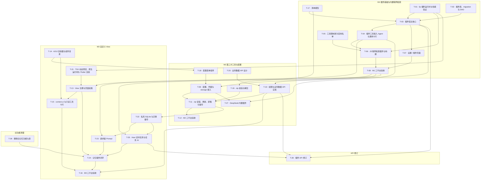

# 插件系统

> 支持平台：Windows、macOS、Android。
> 任务进度只在[实施任务](#实施任务)维护，本文其余部分及分篇说明设计合同和验收要求。

## 文档导航

| 文档 | 内容 |
| --- | --- |
| [架构](architecture.md) | 插件组成、清单、运行时模型、各阶段上下文、业务数据 API、错误约定；接口合同以 [`plugins/sdk/index.d.ts`](../../../plugins/sdk/index.d.ts) 为准 |
| [工具扩展点](tools.md) | 工具注册、命名与覆盖、可用性、工具卡片、Agent 工具限制改造 |
| [联网检索插件](web-plugin.md) | 内置 `WebSearch`、`WebFetch` 的 JS 实现，内置插件的构建与打包 |
| [设置与存储](settings-and-storage.md) | “设置 / 插件”页面、插件状态、配置与凭据、设置页操作、数据库与 migration、zip 安装、备份 |
| [Prompt、定时任务与记忆插件](prompts-and-tasks.md) | 请求级 Prompt、Host 定时任务与调度持久化、记忆插件闭环；通用 Event 与 Hook 留待后续 |
| [自定义 View](views.md) | 插件页面、页面状态、TSX 原生响应式与 Flutter 组件、自定义工具卡片（M3） |
| [验收](verification.md) | 按里程碑的验收标准与测试入口 |

## 背景

### 立项背景

- `WebSearch`、`WebFetch` 用 Dart 写在 [tools.dart](../../../lib/shared/services/ai/tools.dart) 的 `part` 文件 [tools_web.dart](../../../lib/shared/services/ai/tools_web.dart) 中：搜索抓取百度结果页并用正则解析，网页读取用 [html2md](../../../lib/third/html2md/html2md.dart)（turndown 的 Dart 移植）转 Markdown。两个工具始终注册，用户无法关闭。
- 工具可用范围由代码中的白名单决定：[builtin_agent_tools.dart](../../../lib/shared/services/ai/builtin_agent_tools.dart) 为各 Agent 列出工具名，[ai_session_mode.dart](../../../lib/shared/models/ai_session_mode.dart) 为 roleplay 等特殊模式列出工具名；Agent 记录上的 `allowedToolNames` 字段没有开放给用户配置，值也来自代码。
- 立项时应用没有插件机制。MCP 是外部工具接入，按本项目的产品边界不能直接修改系统数据。
- codemode 已接入 fjs（QuickJS），每次执行新建运行时、关闭内置模块、只通过 JSON 桥接调用 Host（[codemode/runtime.dart](../../../lib/shared/services/ai/codemode/runtime.dart)）。
- ADR 0007 至 0012 记录早期插件设计。当前仓库已有插件运行时、Host、数据库、设置与 A2UI 组件实现；本次更新动态 View 方向，不据此宣称既有里程碑已验收。下列立项问题保留作为目标背景。

### 问题

- 用户不能关闭联网检索，也不能换用其他搜索服务。
- 第三方无法为应用增加工具或页面，新能力都要改应用代码。
- 工具白名单按工具名列举，新增任何工具都要逐个修改 Agent 名单。

### 约束

- 插件与内置功能使用同一套 Agent 工具和业务服务，不绕过业务校验、事务和软删除规则。
- 工具名称、description、参数 Schema 和结果字段结构不因插件化改变；修改工具描述需另行确认。
- 新增数据库结构只用列、索引和主键；app 库当前 schema 已发布，需要正式 migration。
- CI 不安装 Node；Flutter 构建只使用已提交的资源。

## 决定与约束

- 清单声明配置字段、设置操作、页面和任务元数据；插件通过统一入口 `apply(setup)` 注册工具、Prompt，并绑定任务与操作 handler，`setup` 只提供注册接口和日志；Host 声明并实现扩展点，在对应操作发生时以该阶段的上下文调用插件的处理函数。一个插件可以同时提供工具、页面等多种能力，不划分互斥的插件类型。
- 内置插件与第三方插件使用同一套 JS 运行时、包格式、表和流程，内置只表示随应用分发。第一个内置插件是联网检索，包含 `WebSearch`、`WebFetch`，默认开启，用户可以关闭。
- 插件运行在 fjs 中；工具按次新建运行时，TSX 页面按实例保持运行时直至关闭，A2UI 页面按 action 执行。插件只能通过 Host API 访问业务能力，网络请求经 Host 完成且不限制目标地址。
- 插件按页面选择 TSX 或 A2UI，同一插件可同时使用；TSX 使用 Rust 原生响应式与批量节点更新，Flutter 负责布局、输入和宿主控件。样式开放 token、布局与组件变体，不引入完整 CSS/Tailwind 或 shadcn React 兼容层。A2UI 同时支持声明式插件页面、配置表单和只读工具卡片。
- 插件在清单中声明业务数据权限，安装时由用户确认，每次调用 Host API 时复查。
- 配置由清单声明、Host 生成表单；凭据保存在应用数据库中，与普通配置分开。
- Agent 工具限制改为代码中的 Host 工具禁用名单，插件工具不进入名单。
- MCP 不作为插件运行时。
- 插件通过 Dart Host 管理的私有 SQLite 持久化结构化数据，Tools、Prompt、任务和 UI 共用同一数据库；不开放宿主主库 SQL。
- Prompt 在模型请求准备阶段按 scope 读取；定时任务由 Host 调度，到期创建短生命周期运行时，不依赖页面打开。应用退出和 Android 后台不承诺定时执行。

## 目标

| 目标 | 成功信号 | 验证位置 |
| --- | --- | --- |
| G1 联网检索可关闭 | 关闭后主聊天和子 Agent 都无法使用两个 Web 工具，重启后保持关闭；重新开启立即可用 | [M1 验收](verification.md#m1-插件基础与内置联网检索) |
| G2 内置功能以插件实现 | 两个 Web 工具由 JS 插件提供，工具契约与原实现一致，原 Dart 实现删除 | [M1 验收](verification.md#m1-插件基础与内置联网检索) |
| G3 第三方可以扩展工具 | 用户安装 zip 插件、填写 Key 后，Agent 可以调用插件工具，第三方搜索插件可替换内置 `WebSearch` | [M2 验收](verification.md#m2-第三方工具与配置) |
| G4 插件可以读写业务数据 | 插件在授权范围内读写章节与人物，修改经过业务校验并进入变更记录 | [M2 验收](verification.md#m2-第三方工具与配置) |
| G5 插件可以提供页面 | 清单声明的页面出现在宿主导航，交互由插件处理，界面使用宿主组件 | [M3 验收](verification.md#m3-自定义-view) |

| G6 记忆模块可由插件交付 | Tools 写入、TSX 管理、下一次请求注入、定时整理与重启持久化形成闭环，停用全部失效 | [记忆插件验收](verification.md#记忆插件端到端验收) |

## 范围与非目标

本方案包含：插件清单与运行时、工具扩展点、内置联网检索插件、Agent 工具限制改造、“设置 / 插件”页面、配置与凭据、插件存储、zip 安装更新与卸载、首批业务数据 API、独立页面形式的自定义 View、自定义工具卡片、私有 SQLite、请求级 Prompt、Host 定时任务和任务专用模型调用。以记忆插件的完整使用闭环作为 M3 成功标准。

本方案不包含：插件市场与自动更新、插件签名与审核、Command / Provider / 菜单入口 / 通用 Event / Hook 扩展点、通用 AI Agent 调用接口、独立页面以外的 View 位置、插件页面内部文案的多语言、进程级隔离、WebView 插件。这些事项见[后续迭代](#后续迭代)。

## User Stories

1. 作为作者，我希望在设置里关闭联网检索，以便 Agent 不再访问网络，且重启后仍保持关闭。
2. 作为作者，我希望安装一个第三方搜索插件并填写它的 API Key，以便 Agent 用我选择的搜索服务替代默认搜索。
3. 作为作者，我希望安装插件前看到它会读写哪些数据，以便决定是否信任它。
4. 作为作者，我希望插件出错、超时或被关闭时，聊天和其他功能照常工作，并能在设置里看到原因。
5. 作为插件作者，我希望用 TypeScript 编写插件、打包成 zip 安装，以便不改应用代码就能增加工具和页面。
6. 作为维护者，我希望内置功能和第三方插件走同一套机制，以便只维护一条加载、注册和启停路径。

## 方案对比与决定

| 决策点 | 备选 | 结论与理由 |
| --- | --- | --- |
| 内置插件实现 | Dart 实现 / 与第三方相同的 JS 实现 | JS。只维护一条加载与注册路径，内置插件同时验证第三方能力；代价是 Web 工具要用 JS 重写 |
| 运行时生命周期 | 全部按次创建 / 每插件常驻 / 工具及 A2UI action 按次、TSX 页面按实例 | 工具及 A2UI action 按次、TSX 页面按实例。工具保留隔离性；页面可以保留状态、绑定与异步任务，多页面与工具不共用运行时。代价是页面需要明确清理、后台暂停和总量限制 |
| HTML 转 Markdown | Host 复用 html2md / 插件内打包 node-html-markdown | 插件内。插件自包含，Host 不为单个插件开专用接口，`lib/third/html2md` 可删除；不要求输出与原实现一致 |
| 凭据存储 | 系统钥匙串等安全存储 / 应用数据库 | 数据库。三平台无需新依赖，与 AI 供应商 Key 现状一致；凭据随备份保存 |
| 业务数据权限 | 启用即全部信任 / 清单声明并由用户确认 | 声明并确认。插件能修改作品数据，用户需要在安装时知道范围 |
| 工具限制 | 保留工具名白名单 / 删除限制 / 代码中的禁用名单 | 禁用名单。保持现有模式与 Agent 的限制，同时新增插件工具无需修改名单 |
| 内置插件构建 | CI 构建 / 本地构建并提交产物 | 本地构建。CI 不需要安装 Node；代价是产物需要手动保持与源码同步 |
| 工具卡片 | 按工具名写专属卡片 / 插件声明展示方式，M3 起可自定义 | 插件声明。第三方工具也能有可读的卡片，Host 不按工具名特殊处理 |
| 安装包格式 | 目录 / zip | zip。便于分发和选择文件，安装时解压校验 |
| 页面后端 | A2UI / TSX，按页面选择 | 两种协议并列支持；TSX 选择原生响应式。自由组合组件，状态和节点细粒度更新；参考 nsh/nsgo 机制，性能由本项目验证。代价是维护编译转换、原生 SDK 与批量桥接，不搬入其布局和平台绘制引擎 |
| 响应式运行时位置 | JS / Dart / Rust | Rust 紧邻 QuickJS，同线程同步处理依赖与 JS 计算，再批量更新 Flutter。Dart 沿用现有异步桥会让依赖链多轮往返，新增同步绑定又需处理线程与重入；JS 方案仍是可行备选。当前选择需要新增并维护 Rust 实现，详见[选型理由](views.md#为什么响应式图放在-rust) |
| 样式与控件 | 完整 Web 样式兼容 / 宿主组件与受控样式 | 自由布局、组合与插槽，加 Reveric token 和控件变体。复用 Flutter 输入、主题、动画和三平台交互，不再造 CSS 或 shadcn 组件库 |
| 私有数据 | KV / 主库专属表 / 私有 SQLite | 每插件独立 SQLite，由 Dart 管理连接、事务、迁移与备份；KV 留给小量设置。插件可自行定义模型，宿主不新增 Memory 专属业务表 |
| 定时任务 | 页面定时器 / 常驻 JS / Host 调度 | Host 持久化周期与启停，到期创建运行时；支持取消、不重入、有限补跑与失败退避。首版只保证应用前台运行时可调度 |
| A2UI | 声明式插件页面、配置与只读卡片 | A2UI 独立支持数据绑定与 action 更新；与 TSX 复用底层 Widget，不共用页面协议或状态 |

实施规格：[TSX SDK](views.md#tsx-sdk-与编译契约)、[节点协议](views.md#节点批次与事件协议)、[nsh/fjs 接入](views.md#nsh-复用与-fjs-接入规格)、[Dart SQLite](settings-and-storage.md#dart-实施规格)。

## 核心原则与关键假设

1. 内置插件不走特殊代码路径；需要区分来源时只看 `source` 字段决定包位置和能否卸载。
2. 插件只通过 Host API 访问能力，Host 从运行时绑定的身份判断权限，不信任插件参数。
3. 插件出错只影响自身能力：激活失败、调用失败都返回明确原因，不影响其他插件和宿主功能。
4. 用户的启停选择只由用户改变，运行失败、平台不支持、版本更新都不改写它。
5. 用户数据默认软删除；卸载和撤销授权只做标记。

| 假设 | 如果不成立 | 应对 |
| --- | --- | --- |
| node-html-markdown 及其依赖打包后能在 QuickJS 中运行 | 依赖 Node 全局对象或不支持的语法 | T-01 先验证；用 esbuild 的 `define` / `inject` 补齐全局对象；仍不可行时改选其他纯 JS 解析库，并回到本方案确认 |
| 每次新建运行时的开销可接受 | 单次工具调用额外耗时或内存过高 | T-01 实测；确认 fjs 是否支持预编译字节码以缩短执行入口的时间，采用前更新本方案 |
| 原生 UI 扩展能在 fjs 中同线程运行并安全释放 JS 引用 | 跨线程读写或桥接成本抵消收益 | T-21 在真实引擎中验证 owner、GC、中断与批次；使用 views.md 已指定的专属 UI 线程和既定 rquickjs 版本；未通过则修复原生边界，不静默改用另一条路线 |
| QuickJS 中转换大网页的耗时可接受 | 接近 5 MB 的页面转换过慢 | 降低 WebFetch 的 `maxBytes`，或先截取 `<body>` 再转换 |

## 里程碑

| 里程碑 | 可交付结果 |
| --- | --- |
| M1 插件基础与内置联网检索 | fjs 插件运行时、清单、`apply`、工具注册与覆盖、插件存储表、网络请求 Host API、通用插件卡片、“设置 / 插件”页面；Web 工具以 JS 插件实现并可关闭；工具限制改为代码中的禁用名单 |
| M2 第三方工具与配置 | zip 安装、更新与卸载，权限确认，配置表单与凭据、设置页操作，`storage` API，首批业务数据 API，插件目录纳入备份；第三方搜索插件可配置 Key、覆盖内置 `WebSearch` 并运行 |
| M3 自定义 View | TSX 编译、原生响应式、批量桥接、Flutter 组件与受控样式、双后端独立页面生命周期、A2UI action、页面 `ui` 接口、A2UI 只读工具卡片；私有 SQLite、Prompt、任务调度及任务 AI；以记忆插件验证完整闭环 |

M1 不依赖渲染器。配置表单由清单生成，使用既有 A2UI，不依赖 TSX 自定义 View。M2、M3 中不依赖插件运行时的部分可以与 M1 并行，见[实施任务](#实施任务)。日期由排期确定，本文不写。

## 风险

| 风险 | 触发条件 | 影响 | 对策 |
| --- | --- | --- | --- |
| 依赖无法在 QuickJS 运行 | node-html-markdown 依赖 Node 全局对象 | M1 网页读取无法实现 | 见关键假设，T-01 最先验证 |
| Android 内存压力 | 工具并发与多个常驻页面叠加 | 应用被系统回收 | 工具和页面分别限额，同时测量进程总峰值；页面关闭清理、隐藏暂停周期任务，见[页面预算](views.md#生命周期与资源限制) |
| UI 桥接与生命周期 | 高频更新、慢消费、异步结果迟到 | 卡顿、旧值覆盖或资源泄漏 | 原生响应式、合并批次、有界队列、稳定节点身份与代次校验；T-21/T-16 验证，失败时定位修复，不自动退回整树 JSON |
| 产物与源码不同步 | 修改 `plugins/` 源码后未重新构建 | 发布的插件行为与源码不一致 | 修改流程要求构建并提交产物；测试校验清单一致；评审时检查 `assets/plugins/` 是否随源码变化 |
| 搜索结果页改版 | 百度调整页面结构 | 搜索解析失败 | 与现状相同，返回 `invalid_response` 并记录日志；插件可单独更新 |
| 历史记录显示异常 | 插件化前的 Web 工具块没有展示元数据 | 旧卡片空白 | 对两个旧工具名保留兼容展示，并有 Widget 测试 |
| 第三方插件越权 | 插件找到 Host API 的越权路径 | 读取或修改授权范围外的数据 | 每次调用复查权限；Host API 单测覆盖越权请求；非敌对代码沙箱，见已知妥协 |
| 工具名冲突 | 两个第三方插件注册同名工具 | 后启用的插件不可用 | 激活失败并显示冲突原因，不静默覆盖 |
| A2UI 协议升级 | A2UI 发布不兼容的新版本 | 渲染器与新版本格式不一致 | 锁定 `a2ui_core` 和 A2UI 版本；升级时保持既有卡片格式兼容，破坏性升级另定卡片协议；不改变 TSX 协议含义 |
| `a2ui_core` 破坏性变化 | 0.x 版本升级改动 API | 渲染器适配代码需要修改 | 锁定版本，只在渲染器内部使用，插件接触不到它的类型 |

## 已知妥协

1. 已解决：插件展示文案支持多语言。
   - 现状：清单的 `name`、`description`，配置字段的 `title`、`description` 与选项 `label`，操作 `title`，页面标题、任务标题和 `ToolDisplay.title` 都是 `PluginText`，可以是字符串或按语言标签提供的对象；Host 依次取当前界面语言、zh-CN、en、第一项。内置插件已提供中英文名称和描述，记忆插件的页面与任务标题也提供中英文。
   - 仍未覆盖：插件页面（TSX / A2UI）内部的文案由插件自行处理，Host 只通过页面环境提供当前 locale；工具 description 和返回给 Agent 的内容属于提示词，不做多语言。内置联网检索的工具卡片未设 `display.title`，仍显示工具名。2. 妥协：内置插件产物没有自动的新鲜度检查。
   - 原因：CI 不安装 Node。
   - 影响：可能提交与源码不一致的产物。
   - 升级触发：出现一次产物不同步导致的问题。
   - 后续方向：在本地提交钩子或 CI 中增加 Node 构建比对。
3. 妥协：凭据以明文存放在应用数据库，并随备份保存。
   - 原因：不引入三平台安全存储依赖，与 AI 供应商 Key 现状一致。
   - 影响：能读取应用数据目录或备份文件的人可以看到凭据。
   - 升级触发：用户要求加密存储凭据。
   - 后续方向：与供应商 Key 一起迁移到系统安全存储。
4. 妥协：JS 运行时不是敌对代码沙箱。
   - 原因：第一版不做进程隔离，见 [ADR-0008](../../adr/0008-plugin-security-capability-allowlist.md)。
   - 影响：恶意插件在授权范围内可以读写数据，并可以访问任意网络地址。
   - 升级触发：开放插件市场或分发来源不可控。
   - 后续方向：签名与审核、进程级隔离。
5. 妥协：卸载不清理文件和数据。
   - 原因：物理删除需要单独确认范围；更新时的旧版本目录会删除，见[安装与更新流程](settings-and-storage.md#安装与更新流程)。
   - 影响：已卸载插件的包文件、配置和凭据占用磁盘空间。
   - 升级触发：用户反馈占用空间。
   - 后续方向：在设置页提供显式清理，范围另行确认。
6. 妥协：`allowedToolNames` 列停止读写但保留。
   - 原因：SQLite 删列需要重建表。
   - 影响：数据库中保留无用列。
   - 升级触发：下次需要重建相关表时。
   - 后续方向：随该次 schema 变更删除。

## 后续迭代

以下事项不属于三个里程碑：

| 事项 | 已有方向 | 何时处理 |
| --- | --- | --- |
| 业务运行时常驻 | 所有业务插件共用一个常驻 fjs 引擎，加载时执行一次 `apply`；保留异步并发，不加全局串行队列；桥接按插件和调用隔离身份、上下文与结果；取消或超时只终止当前调用，更新、禁用及引擎重建时清理或恢复注册；TSX 页面继续各自独立运行时 | T-30，待实施 |
| 更多业务扩展点 | 按实际插件需求增加 Command、Provider、菜单入口、Event 和 Hook，沿用同一注册和释放机制；语义边界见[Event 与 Hook](prompts-and-tasks.md#event-与-hook) | 出现具体插件需求时 |
| 延迟加载的插件工具 | 注册时可选 `exposure: "direct" \| "deferred"`，默认 `direct`。`deferred` 工具不进每次请求的工具列表，由模型按需搜索、查看定义后调用；调用入口可能用新的 `Run plugin ...` 命令，而不复用 `Run mcp`，具体在实施时确定。调用仍经 `PluginAgentToolDispatcher` 检查可用性、写卡片元数据；不能在 codemode 中调用。新增可选字段不破坏 API 版本 | 出现工具数量多、直接放入工具列表会明显占用上下文的插件时 |
| 通用 AI 调用接口 | M3 已包含任务专用 `ai.generateText`；通用 `ai.invoke` 需要独立的任务身份、取消和结果订阅，不受单次执行 60 秒上限约束 | 出现具体插件需求时 |
| AI 生成界面 | Agent 按 A2UI 格式输出界面，复用 A2UI 渲染器和组件目录；新增模型输出解析、由组件目录生成提示词、把界面事件回传给 Agent 的事件处理方 | 出现具体需求时 |
| 其他 View 位置 | 侧栏、人物详情面板、编辑器菜单等 | 出现具体插件需求时 |
| 特殊模式的写入限制 | roleplay、theater、monologue、council 仍禁用 Host 写入工具，可以使用已启用的插件工具 | 以后可能放开，届时只改代码中的禁用名单 |
| `allowedToolNames` 列 | M1 停止读写，列保留 | 后续 schema 变更时删除 |
| 卸载后的文件与数据清理 | 卸载只做标记，不删除插件包、配置和凭据；更新时旧版本目录已删除 | 需要清理时另行确认范围 |
| 插件市场、签名与自动更新 | 不在三个里程碑内 | 另立方案 |

## 既有 ADR 的适用关系

| ADR | 本方案中的关系 |
| --- | --- |
| [0007：运行时与 UI](../../adr/0007-plugin-runtime-fjs-a2ui.md) | 保留 JS、宿主组件和插件身份边界；新增 TSX + 原生响应式 + Flutter 页面后端，使用 `reveric-tsx-v1`。A2UI 与 TSX 并列，插件可按页面选择；配置和只读卡片使用 A2UI，不要求页面迁移到 TSX |
| [0008：权限](../../adr/0008-plugin-security-capability-allowlist.md) | 保留业务能力白名单和逐次检查；网络经 Host 接口提供但不限制目标地址、不单独授权；任务模型生成使用 `ai.generateText` 权限 |
| [0009：API 版本](../../adr/0009-plugin-capability-api-versioning.md) | 保留版本边界与兼容原则 |
| [0010：插件存储](../../adr/0010-plugin-storage-drift-plugin-storage-table.md) | 保留插件数据隔离；KV 与凭据留在主库，结构化数据增加 Host 管理的私有 SQLite；卸载不物理删除 |
| [0011：UI 状态](../../adr/0011-plugin-ui-state-boundary-datamodel-riverpod.md) | 保留页面与全局业务状态边界；TSX 页面局部状态由组件 signal 持有，Host 持有节点与 Flutter 输入状态，页面运行时随实例存活。A2UI 页面仍以 DataModel 为真源并按 action 执行，两者分别维护状态 |
| [0012：注册与授权](../../adr/0012-plugin-registry-permissions-persistence.md) | 保留注册和授权持久化职责；字段以[设置与存储](settings-and-storage.md#表结构)为准，删除改为设置 `deleted_at`；另增 `plugin_secrets` 表 |

已有 ADR 保留原始记录，不表示其中全部历史实施细节已重新获准。

## 实施任务

### Task Graph

### 任务表

状态核对说明：本次按代码核对 T-01 至 T-26 的交付物，均已在代码中找到，因此原“待办”标记已过期，改为“已实现待验收”；“已实现待验收”只表示交付物存在，不代表已按[验收](verification.md)通过。例外如下：

- T-08、T-12、T-16 是三平台验收任务，仓库中没有验收记录，无法核实，标为“无验收记录”。
- T-04、T-13 的交付物存在，但是否完整覆盖任务范围未逐项确认，标为“已实现，待确认”。
- app 库当前 schema 为 3（schema 2 新建插件登记、存储、凭据表；schema 3 新建权限、任务表并删除旧 `memories` 表），不是原记录中的 2。
- T-26 的旧记忆 Service 等代码已删除，旧表由 schema 3 删除，待验收。
- T-27 补登记已实现的 DeepSeek 内置插件；T-28 记录本次插件 API 修订。

| ID | 任务 | 状态 | 依赖 | 当前记录 |
| --- | --- | --- | --- | --- |
| T-01 | [fjs 插件运行时与性能验证](architecture.md#运行时模型) | 已实现待验收 | 无 | 实现 `PluginRuntime` 与前置脚本；验证 node-html-markdown 打包后能在 QuickJS 运行；实测运行时创建耗时、内存、产物体积和大网页转换；确认能否在 `fvm flutter test` 中加载 fjs |
| T-02 | [插件表、migration 与 DAO](settings-and-storage.md#数据库) | 已实现待验收 | 无 | 新增插件表与 `PluginDao` 及升级测试；app 库当前 schema 为 3（原记录为升到 2） |
| T-03 | [插件宿主核心](architecture.md#改动清单m1) | 已实现待验收 | T-01、T-02、T-17 | 内置插件扫描与登记、激活、注册表与覆盖规则、启停、运行状态、网络请求 API |
| T-04 | [插件工具接入 Agent 与通用卡片](tools.md#改动清单m1) | 已实现，待确认 | T-03 | `PluginAgentToolDispatcher` 与各 Agent 创建处的包装、`tool_bridge`、通用插件卡片与历史兼容展示 |
| T-05 | [工具限制改为禁用名单](tools.md#工具限制改为代码中的禁用名单) | 已实现待验收 | 无 | 改 `builtin_agent_tools.dart`、`ai_session_mode.dart`，停止读写 `allowedToolNames`，补对照测试 |
| T-06 | [JS 联网检索插件与构建](web-plugin.md#改动清单m1) | 已实现待验收 | T-01、T-04、T-05 | 新增 `plugins/` 与构建脚本，JS 实现两个工具并迁移测试，提交产物，删除 `tools_web.dart` 与 `lib/third/html2md` |
| T-07 | [设置 / 插件页面](settings-and-storage.md#设置--插件) | 已实现待验收 | T-03 | 不做设计稿，直接按现有设置页样式实现；桌面与移动端插件列表、开关、状态与详情，含 i18n |
| T-08 | [M1 三平台验收](verification.md#m1-插件基础与内置联网检索) | 无验收记录 | T-06、T-07 | 按 M1 验收表在 Windows、macOS、Android 执行 |
| T-09 | [配置、凭据与 storage 接入](settings-and-storage.md#配置与凭据) | 已实现待验收 | T-08、T-18 | 配置表单放入设置页，处理函数上下文的 `settings`、`secrets`、`storage`，待配置状态 |
| T-10 | [权限与业务数据 API 实现](architecture.md#业务数据-api) | 已实现待验收 | T-08、T-20 | 按 T-20 的设计实现权限确认、逐次检查与章节、人物读写 |
| T-11 | [zip 安装、更新、卸载与备份](settings-and-storage.md#安装更新与卸载) | 已实现待验收 | T-09、T-10、T-19 | `PluginInstallOrchestrator`、设置页安装与更新入口、软删除卸载、备份目录 |
| T-12 | [M2 三平台验收](verification.md#m2-第三方工具与配置) | 无验收记录 | T-11 | 用示例第三方搜索插件按 M2 验收表执行 |
| T-13 | [View 注册与页面挂载](views.md#注册与显示) | 已实现，待确认 | T-08、T-21 | 清单 `pages`、必填 `home.plugin` 位置与页面 protocol；A2UI `pages.registerAction`、TSX JS/A2UI 消息校验、导航与多实例会话；dirty 确认、停用/更新释放及后台暂停 |
| T-14 | [A2UI 渲染器与组件目录](views.md#a2ui-页面与声明式界面) | 已实现待验收 | 无 | 保留已实现的 A2UI v1.0、`a2ui_core: 0.4.0`、组件、预览和测试，服务 A2UI 页面、配置与只读卡片；不作为 TSX 编译器或页面状态层 |
| T-15 | [context.ui 与自定义卡片](views.md#自定义工具卡片) | 已实现待验收 | T-13、T-14 | A2UI action 按次执行、消息更新、过期结果拒绝；页面临时 UI 使用宿主控件与平台交互；`display.view` 保留只读 A2UI，不执行页面 JS；历史卡片回退 |
| T-16 | [M3 三平台验收](verification.md#m3-自定义-view) | 无验收记录 | T-10、T-15、T-24 | 以记忆插件执行 Tools、Prompt、TSX UI、定时整理、存储与启停闭环；人物整理只验证宿主数据 API |
| T-17 | [清单模型](architecture.md#清单结构) | 已实现待验收 | 无 | 从 T-03 拆出先做：`lib/shared/models/plugin/manifest.dart` 解析与校验 `plugin.json` 及测试，供 T-03、T-19 共用；`settings.fields` 交给 T-18 已有的 `parsePluginSettingFields` 解析 |
| T-18 | [配置表单组件](settings-and-storage.md#配置与凭据) | 已实现待验收 | T-14 | 按清单 `settings.fields` 用 A2UI 组件库生成表单，字段解析与校验在 `setting_field.dart`，含 Widget 测试；放入设置页在 T-09 |
| T-19 | [zip 校验与解压](settings-and-storage.md#包格式) | 已实现待验收 | T-17 | 可与 M1 并行。路径穿越、符号链接、大小与条目数限制、清单位置检查及解压，纯函数加单测 |
| T-20 | [业务数据 API 设计](architecture.md#业务数据-api) | 已实现待验收 | 无 | 可与 M1 并行。确定首批章节与人物接口签名、权限名、对应 Service 入口与版本字段；结果写入 `plugins/sdk/index.d.ts` 的声明与注释 |
| T-21 | [TSX 动态预览与渲染运行时](views.md#渲染器与组件目录) | 已实现待验收 | T-01 | TypeScript AST 转换与已定稿 SDK、固定 nsh 核心提取、fjs 同引擎专属 UI 线程、类型化批次协议、Flutter 组件和 token；交付可独立运行的动态预览、输入/异步/清理测试及性能基准 |
| T-22 | [私有 SQLite 与生命周期](settings-and-storage.md#插件私有-sqlite) | 已实现待验收 | T-11 | 现有 sqlite3 3.7.0、Dart 后台连接、三种 SQL API、类型编码、私有库归属/事务/结果限额、等待超时语义、清单迁移、一致性备份与失败恢复；不增加插件专属主库表 |
| T-23 | [请求级 Prompt](prompts-and-tasks.md#请求级-prompt-提供方) | 已实现待验收 | T-04、T-22 | 注册只读提供方；请求身份、作品 scope、预算、超时省略、启停和重试快照；与内层提示共存 |
| T-24 | [记忆插件](prompts-and-tasks.md#记忆插件验收闭环) | 已实现待验收 | T-13、T-23、T-25、T-26 | 插件自有 migration、四个 Tools、Prompt、TSX 管理与整理候选；同一份数据贯通；不继承旧记忆 |
| T-25 | [Host 定时任务](prompts-and-tasks.md#host-定时任务) | 已实现待验收 | T-03、T-22 | 注册/调度/持久化、设置页控制、前后台与补跑、取消/退避/租约、任务 AI 与模型用量、Host plugin_tasks 状态表；不运行常驻 JS |
| T-26 | [删除旧记忆](prompts-and-tasks.md#旧功能删除范围) | 已实现待验收 | 无 | 已获准连同旧表和历史数据删除；旧记忆 Service 等代码已删除，schema 3 删除旧 `memories` 表，待验收 |
| T-27 | DeepSeek 搜索 / 读取内置插件 | 已实现待验收 | T-04、T-09 | `plugins/deepseek`（`reveric.deepseek`）：DeepSeek 网页搜索与页面读取工具，默认关闭，需配置 API Key，提供 `verifyApiKey` 设置页操作；中英文名称与描述；产物在 `assets/plugins/reveric.deepseek/` |
| T-28 | [插件 API 修订](architecture.md#插件上下文-api) | 已实现待验收 | T-03、T-10、T-25 | 以 `plugins/sdk/index.d.ts` 为唯一合同：`apply(setup)` 只注册，各阶段独立上下文；移除 `cancelled`；`PluginError` 与 code 原样上报；`setup.settings.registerAction`；`PluginText` 多语言文案；数据 API 只返回摘要、`update` 使用 `patch`，移除 `listAcrossWorks` 与 `readAll`；每次注册批量上报并由 Host 核对清单及激活快照；移除任务 `definition_hash`；结果严格 JSON |
| T-29 | [plugin.json 重构](architecture.md#清单结构) | 已实现，本地回归通过 | T-28 | 提交 `b734c0c`：`settings.fields/actions`、`pages`（`home.plugin`）、`tasks`；页面与卡片各自声明协议；SDK、宿主、内置插件和产物同步，不保留旧格式兼容。124 个 Dart/Flutter 测试、77 个 JS 测试通过，静态分析通过；未运行原生整机集成测试，不替代三平台验收 |
| T-30 | 业务插件共用常驻 fjs 运行时 | 待实施 | T-29 | 方向见[后续迭代](#后续迭代)；当前工具、Prompt、任务、设置操作和 A2UI 事件仍按次创建运行时，TSX 页面维持独立实例 |
