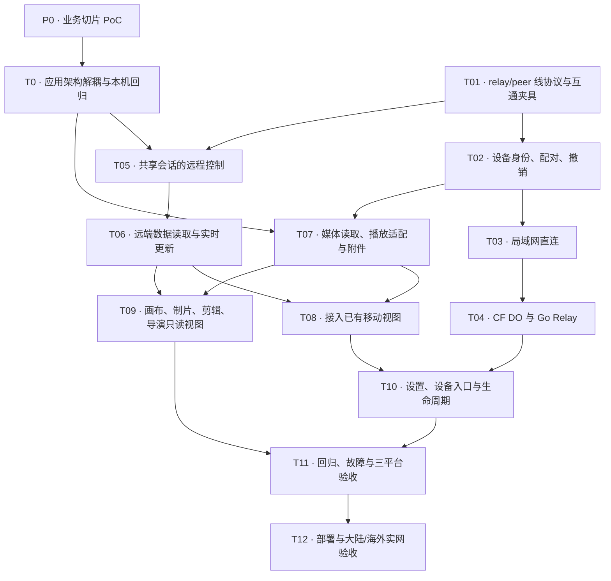

# 设备远程访问：局域网优先与加密 Relay

本目录把已确认的产品范围细化为实现方案。产品决策见 [ADR-0040](../../adr/0040-remote-access-preserves-device-local-ownership.md)，术语见 [CONTEXT.md](../../../CONTEXT.md)。整个目录都是设计：文中的接口、模块、依赖和默认参数还没有写成代码，Relay 服务也没有部署，各分篇不再逐处重复这一点。

> 支持平台：Windows、macOS、Android。任务状态只在本文末尾的[实施任务](#实施任务)维护。
>
> 术语：拥有作品并运行 Agent 的一方称**被访问端**（Accessed Device），查看并指挥的一方称**访问端**（Accessing Device），定义见 CONTEXT.md。Host、Client 只指两端的远程访问组件与线协议角色。“电脑”“手机”仅在描述 MVP 的具体平台（Android 访问 Windows、macOS）时使用。

## 文档导航

| 文档 | 唯一维护的内容 |
| --- | --- |
| [应用架构解耦](application-decoupling.md) | P0 业务切片 PoC 与前置工程 T0：目标契约、模型与远程转换、状态归属、渐进迁移与画布改造示例 |
| [架构与技术选择](architecture.md) | 组件关系、依赖、展示策略、风险与取舍 |
| [连接与配对](connection.md) | 设备身份、邀请、发现、路径切换、加密、协议协商与传输限额 |
| [线协议与多端生成](wire-protocol.md) | Protobuf 分层、帧字段、注册与路由状态机、局域网链路、流控及兼容性 |
| [CF DO 实现](cloudflare-relay.md) | Worker 路由、DO 状态与休眠、持久化、用量监控、部署和升级 |
| [Go 自建实现](self-hosted-relay.md) | Go 进程、注册表、连接并发、Caddy、容器和退出恢复 |
| [业务协议与执行](protocol.md) | RPC 方法、命令确认、单槽队列、审批、AskUser、快照与增量 |
| [移动视图与媒体](views-and-media.md) | 页面覆盖、用户流程、数据归属、插件展示、附件、资源读取与播放 |
| [设置、部署与成本](settings-and-deployment.md) | 配置与凭据、本地表、两种 Relay、平台权限、升级回退、运行费用与发布观察 |
| [实施落点](implementation.md) | 现有文件的改动范围、新模块职责和目录 |
| [验收](verification.md) | 功能与故障矩阵、跨平台网络验收、测试命令与发布门槛 |

建议先读本页的[全过程](#一次远程访问的全过程)，再读架构、连接和业务协议，之后按需要读视图或部署；动手实施前核对实施落点与验收。产品决定以本页为准，业务协议字段和线协议字段分别在各自分篇维护。

## 背景与现状

用户希望在手机上查看电脑里的作品，继续同一个 Agent 会话，检查生成结果并处理审批。现有的微信入口以消息为载体，由独立助手分派作品任务，承载不了完整的作品视图、实时会话和结构化审批。所以远程访问作为独立功能接入，现有消息渠道保留，改称 IM Channels。

### 当前可以复用的代码

| 能力 | 当前实现与接入方式 |
| --- | --- |
| IM 入口 | `lib/shared/services/remote/` 与 `lib/shared/providers/remote_bridge_providers.dart`；保持现有行为，新设备协议不放进 IM adapter |
| 正常会话执行 | `lib/shared/services/ai/chat_session_controller.dart` 的 `ChatSessionController`、`ChatHost`、`ChatComposerStore`；需要补一个不依赖页面的入口，并返回明确的接收结果 |
| 会话运行态 | `lib/shared/providers/ai_providers.dart` 的 `AiChatRuntime`；已有活动 Agent、单槽队列、AskUser 和会话存活管理 |
| 工具审批 | `lib/shared/agent/tool_approval.dart`；审批参数冻结，由同一 broker 处理一次性决策 |
| Agent 提问 | `lib/shared/services/ai/pending_ask_user.dart`；普通交互式执行可以脱离聊天页面等待回答 |
| 历史与操作恢复 | `lib/shared/services/ai/session_persistence.dart`、`tool_operations.dart`；没有活动执行体的历史操作可恢复为中断状态 |
| 移动视图 | 章节、人物、剧本、地图、关系图、聊天和插件页已有入口；部分组件仍直接依赖本地数据库与文件 |
| 普通画布 | `lib/desktop/features/canvas/widgets/canvas_board.dart` 已有 `editable: false` 查看模式；外层和节点引用仍需数据适配 |
| 制片工作区 | `lib/desktop/features/production/region.dart` 组合制作、剪辑和共享导演台；移动端还没有完整入口 |

有三处现状直接影响设计：

1. `runHeadlessSessionTurn` 会注入 `AskUserResult.timeout`，Agent 提问会被自动按超时处理。远程会话要走正常的交互式执行链。
2. 当前 `send()` 返回 `Future<void>`，队列被占用等拒收情况也可能正常返回，远程接口无法据此判断是否发送成功。
3. 运行态和审批对象主要在内存里，消息历史也不是命令接收回执，因此无法保证跨数据库、文件和供应商调用的严格一次执行。

## 一次远程访问的全过程

下面以 Android 手机访问 macOS 电脑为例，串起各分篇的主要机制。

1. **配对**：电脑在设置里开启远程访问，显示一个 5 分钟有效的二维码，里面有电脑的公钥、所选 Relay 地址和局域网地址。手机扫码后先与电脑完成加密握手，再提交配对秘密；电脑确认后保存手机公钥，并发给手机一份它独有的加入凭据。详见[设备身份和配对](connection.md#设备身份和配对)。
2. **连接**：手机先试局域网，2 秒内连不上再走 Relay。两条路径都用 Noise 端到端加密，Relay 只转发密文。详见[局域网优先与切换](connection.md#局域网优先与切换)和[加密发生在哪里](wire-protocol.md#e2e-加密发生在哪里)。
3. **查看内容**：手机打开画布时发出订阅请求，电脑在本机监听同一个画布查询，数据库每变化一次就推送一份完整快照，手机整块替换显示。详见[远程如何实现 watch](application-decoupling.md#远程如何实现-watch)。
4. **发指令**：手机发出指令后，电脑决定立即执行、排队或拒收，并回一个回执，手机据此清空或保留输入框。回执没收到时，手机用原命令 ID 去查，不重新发送。详见[命令确认](protocol.md#命令确认去重与单槽队列)。
5. **审批**：Agent 要执行需要审批的工具时，两端都会看到审批卡，先处理的一端生效，另一端刷新为已处理。详见[审批与 AskUser](protocol.md#审批与-askuser)。
6. **看视频**：手机播放器请求本机 loopback（`127.0.0.1`）上的一个地址，适配器把每个 Range 请求换成一次加密的按范围读取。详见[视频](views-and-media.md#视频经加密通道按范围读取)。
7. **断线与重启**：手机断线或退出不影响电脑上正在跑的任务；重连后重新订阅，用新快照校准。电脑重启后，手机上尚未确认的命令显示“结果不确定”，请用户查看会话。
8. **撤销**：在电脑上撤销这台手机后，它的连接立即断开，Relay 也不再让它加入；其他手机不受影响。

### 常用术语

| 术语 | 含义 |
| --- | --- |
| Relay | 跨网络时转发两端密文的中转服务，有官方 Cloudflare 和自建 Go 两种实现 |
| DO | Cloudflare Durable Object，官方 Relay 中每条路由对应一个 DO 实例 |
| Noise | 两端之间的加密握手协议，本方案用 `Noise_IK`，密钥只在两端设备上 |
| 加入凭据 / join digest | 每台访问端独有的 Relay 加入秘密；Relay 只保存它的 SHA-256 摘要（digest） |
| routeId | 被访问端在 Relay 上的路由标识 |
| hostEpoch | 被访问端进程每次启动生成的代次号，用于识别重启 |
| 替换快照 / 增量 | 内容订阅每次推送完整状态；会话消息和 token 流只推送变化，需要按版本拼接 |
| 单槽队列 | 同一会话同时只有一个活动回合和一个待发送位置 |

## 目标与范围

### 已确认的产品决定

| 编号 | 决定 |
| --- | --- |
| R1 | 设备概念对等，角色按访问方向确定。MVP 为 Android 访问 Windows、macOS，暂不提供电脑操作手机 |
| R2 | 作品、配置、模型调用、Agent 与任务留在被访问端；访问端不保存可离线使用的作品副本 |
| R3 | 人对业务内容只读，可以新建会话、发送指令、停止、回答提问、批准或拒绝工具操作 |
| R4 | Agent 能力与被访问端已有能力一致，不要求先给所有 UI 操作补齐对应工具 |
| R5 | 可访问既有会话，也能在被访问端新建会话；不另建远程助手会话层 |
| R6 | 两端各自导航；发送时固定作品及适用的季、分集等上下文，不跟随另一端切页 |
| R7 | 同一会话一个活动回合、一个共享待发送位置。位置被占用时保留新输入，接收确认来自被访问端 |
| R8 | 手机断线不取消已启动任务；被访问端退出或重启后，不自动重放未完成的写入 |
| R9 | 配对授予设备级访问，可查看全部作品、指挥 Agent 和审批；执行仍受已有工具权限约束 |
| R10 | 扫码配对，不需要账号；可在被访问端撤销配对 |
| R11 | 局域网直连优先，跨网走选定的 WebSocket Relay；首版不做公网 P2P 或 TURN |
| R12 | 官方 Cloudflare 与自建 Relay 共用协议。自建模式的配对、发现和连接不依赖官方服务，失败时也不切回官方 |
| R13 | 已配对设备在 Relay 不可用时仍可局域网直连；大陆和海外网络都要验收 |
| R14 | 控制与全部资源（含视频）端到端加密，视频按范围读取，同网直连、跨网经 Relay；Relay 不持久保存业务内容，访问端临时文件在访问结束时清理 |
| R15 | 前台实时更新，回到前台时校准状态；MVP 不承诺锁屏通知及时到达，不新建推送服务 |
| R16 | 复用真实移动视图并补齐[平台展示差距](views-and-media.md#平台展示差距)；现有微信归入 IM Channels，继续可用 |

### 非目标与承诺边界

不提供操作系统远程桌面、鼠标键盘注入、多用户作品共享、离线作品编辑合并、云端 Agent 托管，也不自动唤醒已关机的设备。MVP 不开放远程修改供应商密钥、平台权限和配对设置的接口。

只读限制的是人直接编辑业务内容。Agent 按指令修改内容仍然允许，权限由被访问端现有的工具体系裁决。新建会话、回答提问、审批和停止是明确开放的控制操作。

“数据留在本地”指远程访问的存储归属，不改变用户原有的 AI 供应商、工具或对象存储行为。模型请求仍按被访问端的配置发送，已有工具会用到的外部服务照常使用。

## 可验收目标

| 目标 | 通过条件 | 验收位置 |
| --- | --- | --- |
| G1 同一设备上的同一份工作 | 手机可查看作品并继续电脑上的现有会话，不创建本机作品副本 | [内容与视图](verification.md#内容与视图) |
| G2 Agent 交互完整 | 发送、单槽排队、停止、提问与审批都由被访问端确认，断线不重复执行 | [会话控制](verification.md#会话控制) |
| G3 真实结果可检查 | 普通画布、制作、剪辑、导演视图及音视频能在手机上只读查看 | [内容与视图](verification.md#内容与视图) |
| G4 网络路径符合选择 | 同网优先直连，跨网走所选 Relay；官方不可达时，自建 Relay 和已配对设备的局域网连接不受影响 | [连接与授权](verification.md#连接与授权) |
| G5 本地归属与撤销有效 | Relay 不落盘业务内容，访问结束清理临时数据，撤销立即阻断新操作和资源读取 | [连接与授权](verification.md#连接与授权)、[媒体与存储](verification.md#媒体与存储) |

## 实施任务

核对日期：2026-11-02；分支：`unstable`；代码基线：`bc02e17`。任务状态来自源码核查，不是测试结果；现有测试文件的存在不算验收通过。

整个目录描述一个完整的 MVP，一次性交付。任务拆分是为了能独立提交、理清依赖：协议库、服务适配和本地组件可以先合入并测试，但用户入口在整体验收完成前一直关闭。任务进度只在本节维护。

实施顺序：

1. **[P0 业务切片 PoC](application-decoupling.md#p0业务切片-poc)**：以画布订阅和会话控制为切片，用局域网明文 WebSocket 和 JSON 编解码器，验证远程订阅和不依赖页面的会话控制。画布改造、会话接收结果和接口骨架直接留作 T0 及后续任务的代码，明文传输和 JSON 实现之后替换。
2. **[T0 应用架构解耦](application-decoupling.md)**：保留 Riverpod，按完整业务模块分批迁移查询、命令、运行状态和资源访问，每批完成后本机功能照常可用。T0 覆盖远程 MVP 会展示或控制的全部模块；它只做本机改造，不包含远程功能。T05～T09 依赖业务契约，要等 T0 全部完成后才开始。
3. **T01～T04 与 T0 并行**：它们不依赖业务模型。T01 建立 relay 与 peer 层的 `.proto`、本地生成工具链和三语言互通夹具，T02～T04 在此基础上实现配对、局域网和两种 Relay。
4. **T05 起按依赖图推进**：各业务模块的 `app/v1` schema 与编解码器随 T05、T06 按模块落地，同一模块的 schema、编解码器和往返夹具一起提交，客户端和 Host 不各自发明业务投影。部署地址、账号和镜像摘要等到部署时再填写，不影响 T0。

依赖图省略了能由前置链推导出的箭头，完整的直接依赖以任务表为准。

| ID | 可独立验收的交付结果 | 状态 | 依赖 | 当前记录 |
| --- | --- | --- | --- | --- |
| P0 | [业务切片 PoC](application-decoupling.md#p0业务切片-poc) | 待办 | 无 | Android 经局域网明文 WS 和 JSON 编解码器订阅 macOS 画布、控制会话；Android 只做 Debug 诊断页，不移植画布。画布改造与接口骨架保留，传输与 JSON 实现丢弃 |
| T0 | [应用架构解耦](application-decoupling.md) | 待办 | P0 | 设计与画布示例已写好，代码未动。第 1 批由 P0 完成，其余模块分批迁移；全部通过完成标准和三平台本机回归后开始 T05 |
| T01 | [relay/peer 线协议与跨实现夹具](wire-protocol.md#两层协议与代码生成) | 待办 | 无 | 建立 Buf 工具链，生成 Dart、Go、TS 的 relay 与 peer 层类型，用同一批夹具验证三种语言和两种 Relay |
| T02 | [设备身份、扫码配对和撤销](connection.md#设备身份和配对) | 待办 | T01 | 现有微信登录没有设备身份概念，新增独立的信任记录和系统安全存储 |
| T03 | [不依赖 Relay 的局域网连接](connection.md#局域网优先与切换) | 待办 | T02 | 增加监听、DNS-SD、固定身份验证和权限被拒时的处理 |
| T04 | [同协议的 CF 与自建中转](settings-and-deployment.md#relay-部署合同) | 待办 | T02、T03 | 两种 Relay 的实现、休眠恢复、路由验证、背压和容器部署 |
| T05 | [共享会话的远程控制](protocol.md#命令确认去重与单槽队列) | 待办 | T0、T01 | 在 T0 做好的会话命令入口（不依赖聊天页）上接入远程：补会话的 `app/v1` schema 和编解码器，加命令回执、去重和租约，接入排队、审批和提问 |
| T06 | [远端数据读取与实时更新](protocol.md#快照事件与浏览上下文) | 待办 | T05 | 按模块补齐内容查询的 `app/v1` schema 与编解码器，通过类型化描述接入远程来源；实现替换快照订阅、资源目录和重连校准，不再拆分业务 UI |
| T07 | [媒体播放与输入附件通路](views-and-media.md#资源媒体与临时数据) | 待办 | T0、T02 | 资源与视频的加密范围读取、loopback 播放适配、媒体流控与输入附件 |
| T08 | [已有移动视图接入远程来源](views-and-media.md#平台展示差距) | 待办 | T05、T06、T07 | 复用正文、地图、关系图、聊天和插件展示；关闭内容编辑入口，保留浏览交互 |
| T09 | [补齐复杂工作区只读展示](views-and-media.md#平台展示差距) | 待办 | T06、T07 | 普通画布已有查看模式；制作、剪辑和导演台需要独立的移动宿主和只读行为 |
| T10 | [设置、设备入口与生命周期](implementation.md#设置启动和本地化) | 待办 | T02、T03、T04、T08 | 新入口与 IM Channels 分开；完成三平台权限、i18n 和启动恢复 |
| T11 | [本机回归与故障矩阵](verification.md) | 待办 | T07、T08、T09、T10 | 串行运行相关测试，覆盖两端竞争、断线、重启、撤销、解码失败和缓存清理 |
| T12 | [官方及自建的实网交付](verification.md#发布门槛) | 待办 | T11 | 需要实际部署地址，在大陆/海外和 Windows/macOS/Android 上跑完矩阵；部署凭据不进入 App |
